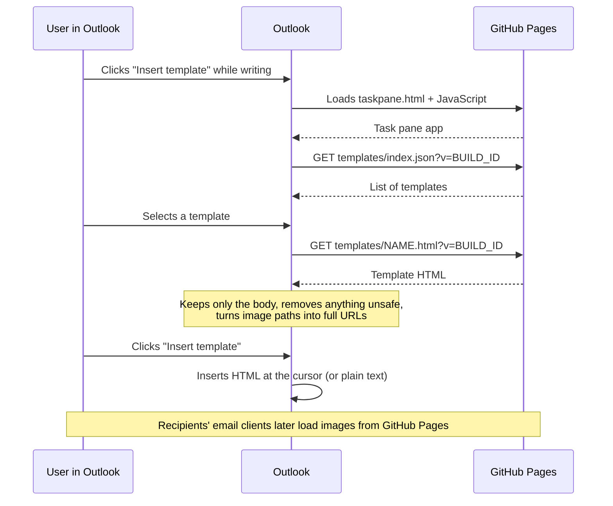

# Outlook Email Templates add-in

An Outlook add-in that lets people insert approved, company-branded email templates into the message they are writing. IT keeps the templates in this repository. GitHub publishes them automatically and checks every change first.

> **New to GitHub?** Start at [Part 4: Working with GitHub](#part-4-working-with-github). If you only need to add or change a template, go to [Part 5: Adding or editing a template](#part-5-adding-or-editing-a-template).

## Contents

- [Part 1: What this is](#part-1-what-this-is)
- [Part 2: Repository map](#part-2-repository-map)
- [Part 3: Working on a locked-down corporate PC](#part-3-working-on-a-locked-down-corporate-pc)
- [Part 4: Working with GitHub](#part-4-working-with-github)
- [Part 5: Adding or editing a template](#part-5-adding-or-editing-a-template)
- [Part 6: First-time setup checklist](#part-6-first-time-setup-checklist)
- [Part 7: How the code works](#part-7-how-the-code-works)
- [Part 8: Troubleshooting](#part-8-troubleshooting)
- [Part 9: Optional: running everything on an unrestricted computer](#part-9-optional-running-everything-on-an-unrestricted-computer)

---

## Part 1: What this is

### What the add-in does

- Adds an **Insert template** button to the ribbon when you write a new message, reply or forward, in **classic Outlook for Windows**, **new Outlook** and **Outlook on the web**.
- The button opens a side panel (the *task pane*). In classic Outlook you can pin it so it stays open.
- In the task pane you can:
  - **search** by name, description or keyword;
  - **filter** by category;
  - **preview** a template;
  - **insert** it where your cursor is. If you have selected text, the template replaces it.
- If the message is in plain-text format, a text-only version is inserted and you see a notice.

### What it does not do

- It does not set the subject, recipients or attachments.
- It has no placeholders (such as `{{DisplayName}}`) yet.
- It does not show different templates to different groups. Everyone sees every template, grouped by category.
- It does not support Outlook for Mac or mobile.
- There is no sign-in, Entra app registration, SharePoint or server.

### How templates are hosted

All templates are plain HTML files in the [templates/](templates/) folder. When a change reaches the `main` branch, a GitHub Actions workflow (an automated job that GitHub runs for you) does the following:

1. checks every template;
2. builds the add-in;
3. creates `index.json`, a list of all templates;
4. publishes everything to **GitHub Pages**, GitHub's free static website hosting, at `https://<org>.github.io/<repo>/`.

`<org>` is your GitHub organization or user name and `<repo>` is the repository name.

> **Privacy:** anyone with the URL can read the published templates and images. Never put internal-only content in a template. If the repository is public, its source code and history are public too.

### How a request flows



The add-in and the templates are served from the same site, so there's no cross-site (CORS) setup.

---

## Part 2: Repository map

```
.
├── README.md                     This guide
├── docs/
│   └── deployment.md             Short admin runbook (setup, publishing, admin center)
├── templates/                    THE EMAIL TEMPLATES (this is what IT edits most)
│   ├── *.html                    One file per template
│   └── images/                   Images used by templates (logo.png, ...)
├── scripts/
│   └── Publish-TemplateIndex.ps1 Checks the templates and writes index.json
├── tests/
│   └── Publish-TemplateIndex.Tests.ps1   Pester tests for the script above
├── addin/                        The Outlook add-in (web app)
│   ├── manifest.json             Unified manifest: tells Outlook about the add-in (default)
│   ├── manifest.xml              Older XML manifest (fallback only)
│   ├── assets/                   Add-in icons (ribbon button, admin center)
│   ├── package.json              JavaScript dependencies and npm commands
│   ├── webpack.config.js         Build settings; the single place URLs come from
│   ├── tsconfig.json             TypeScript compiler settings
│   ├── tsconfig.test.json        TypeScript settings for unit tests
│   ├── jest.config.js            Unit test settings
│   ├── eslint.config.mjs         Code style (lint) rules
│   ├── src/
│   │   ├── globals.d.ts          Declares the build-time constants
│   │   └── taskpane/
│   │       ├── taskpane.html     Page Outlook loads; includes Office.js
│   │       ├── index.tsx         Starts the app when Office is ready
│   │       ├── components/
│   │       │   ├── App.tsx       The whole task pane UI
│   │       │   └── TemplatePreview.tsx  Sandboxed preview frame
│   │       └── lib/
│   │           ├── config.ts         Templates URL and build id
│   │           ├── fetchTemplates.ts Downloads index.json and templates
│   │           ├── templateIndex.ts  Checks and sorts the list from index.json
│   │           ├── filter.ts         Search and category filter
│   │           ├── templateHtml.ts   Body extraction, sanitizing, URL fixing, plain text
│   │           └── outlook.ts        Talks to Outlook (insert at the cursor)
│   └── tests/                    Jest unit tests for the lib/ files
├── .github/workflows/
│   ├── ci.yml                    Checks every pull request
│   └── deploy.yml                Publishes to GitHub Pages after changes to main
├── .gitignore                    Files Git must not store (node_modules, dist, ...)
└── .gitattributes                Line endings and binary file settings
```

Generated files are never stored in the repository. GitHub Actions creates them each time it runs:

- `addin/node_modules/`: downloaded JavaScript packages;
- `addin/dist/`: the built website;
- `templates/index.json`: the template list.

### The published site

```
https://<org>.github.io/<repo>/
├── taskpane.html, taskpane.<hash>.js   The add-in
├── assets/                             Icons
├── manifest.json, manifest.xml         Manifests with the real URLs
└── templates/
    ├── index.json                      Generated list of templates
    ├── *.html                          Templates
    └── images/                         Template images
```

---

## Part 3: Working on a locked-down corporate PC

This project is set up so that nothing needs to be installed on a restricted PC.

| Task | Where | Tools needed |
| --- | --- | --- |
| Edit templates, images, docs, source code | Corporate PC (any text editor, e.g. VS Code) or the GitHub website | None |
| Check templates, run tests, lint, build | **GitHub Actions** (GitHub's own computers, called *hosted runners*) | None on your PC |
| Publish to GitHub Pages | **GitHub Actions** | None on your PC |
| Upload the manifest to Microsoft 365 | Web browser (admin center) | None |
| Run tests locally or sideload into Outlook for debugging | **Optional**, unrestricted computer only | Node.js, PowerShell 7, Pester |

You never need to run `npm`, build or test commands on the corporate PC. Push your change to a branch, open a pull request, and GitHub runs all the checks for you.

> **About `package-lock.json`:** this file records the exact version of every JavaScript dependency. It can only be created by running `npm install`, so the repository doesn't include one yet. Until it exists, GitHub Actions runs `npm install` and gets the newest compatible versions. When you have an unrestricted computer, create the file once and commit it (see [Part 9](#part-9-optional-running-everything-on-an-unrestricted-computer)). After that, Actions switches to `npm ci` automatically, so builds are repeatable.

---

## Part 4: Working with GitHub

### Terms you'll see

| Term | Meaning |
| --- | --- |
| **Repository (repo)** | The project folder stored on GitHub, with its full history. |
| **Commit** | A saved snapshot of changes, with a message describing them. |
| **Branch** | A separate line of work. `main` is the live branch; you make changes on your own branch. |
| **Pull request (PR)** | A request to merge your branch into `main`. Others review it and the automatic checks run on it. |
| **Merge** | Applying the pull request's changes to `main`. |
| **GitHub Actions** | GitHub's automation. The workflows in `.github/workflows/` define what runs. |
| **Workflow run** | One execution of a workflow. Green tick = passed, red cross = failed. |
| **Artifact** | A file a workflow run produces that you can download (e.g. the manifests). |
| **GitHub Pages** | GitHub's static website hosting, where the add-in is served from. |

### Getting the repository

- **Creating it (admin):** on GitHub, click **+ > New repository**, choose the owner (your organization), a name (this becomes `<repo>` in the URL, so choose carefully; renaming later breaks images in emails that were already sent), and the visibility ([see Part 6](#part-6-first-time-setup-checklist)). Then upload this folder's contents, either by dragging the files onto **Add file > Upload files** on the repository page or with Git from the command line.
- **Receiving access:** an admin adds you under **Settings > Collaborators and teams**. You'll get an email invitation.

### The repository page

- **Code** tab: the files. Click a folder to open it, click a file to view it.
- **Pull requests** tab: open and past change requests.
- **Actions** tab: workflow runs (CI and Deploy) with their logs.
- **Settings** tab (admins only): Pages, branch rules, Actions permissions.
- The branch selector (top left of the file list, usually showing `main`) switches between branches.

### Making a change in the browser (simplest)

Good for editing a template or this README.

1. Open the file on GitHub and click the **pencil icon** (Edit this file). To add a file, open the folder and click **Add file > Create new file** or **Upload files**.
2. Make your change.
3. Click **Commit changes...**.
4. Write a short message, e.g. "Add holiday closure template".
5. Choose **Create a new branch for this commit and start a pull request**. GitHub suggests a branch name; you can keep it.
6. Click **Propose changes**, then **Create pull request**.

If `main` is protected (recommended), GitHub will offer the new-branch option automatically.

### Making a change on your PC with Git (optional)

If Git is already available:

```powershell
git switch -c add-holiday-template      # create and switch to a new branch
# ...edit files...
git add templates/holiday-closure.html templates/images/holiday.png
git commit -m "Add holiday closure template"
git push -u origin add-holiday-template # upload the branch to GitHub
```

GitHub then shows a **Compare & pull request** button on the repository page.

### Reviewing CI results

1. Open the pull request. At the bottom you'll see the checks: **CI / Templates and PowerShell** and **CI / Add-in**.
2. A yellow dot means running, a green tick means passed, a red cross means failed.
3. Click **Details** next to a failed check to open the log. Expand the red step to see the error.
4. Template problems also appear as **annotations**: messages linked to the file. Look under **Files changed** or in the run summary.

### Fixing failures

Edit the files on the **same branch** (open the file from the pull request's **Files changed** tab, or switch the branch selector to your branch). Commit again. The checks re-run automatically. See [Part 8](#part-8-troubleshooting) for common errors.

### Merging

When the checks are green and a reviewer has approved, click **Merge pull request > Confirm merge**. You can then delete the branch (GitHub offers a button).

### Finding the deployment

1. Open the **Actions** tab and click the **Deploy** workflow on the left.
2. The newest run at the top corresponds to your merge. Wait for the green tick.
3. Open the run. The **deploy** box shows the site link. Downloadable files (the manifests) are under **Artifacts** at the bottom of the run page.
4. The repository's **Environments > github-pages** section (right-hand side of the Code tab) also lists every deployment.

Users see the change within about 10 minutes of the deployment finishing.

### Undoing a change

Open the merged pull request and click **Revert**. This creates a new pull request that undoes the change. Merge it like any other.

---

## Part 5: Adding or editing a template

### The template format

One `.html` file per template, directly in `templates/` (no subfolders). Example:

```html
<!DOCTYPE html>
<html lang="en">
<head>
  <meta charset="utf-8">
  <meta name="template-name" content="Holiday closure">                  <!-- required -->
  <meta name="template-category" content="General">                     <!-- required -->
  <meta name="template-description" content="Office closed notice.">    <!-- optional -->
  <meta name="template-keywords" content="holiday, closed, christmas">   <!-- optional, comma-separated -->
  <title>Holiday closure</title>
</head>
<body>
  <p style="font-family: Calibri, Arial, sans-serif; font-size: 11pt;">Hello,</p>
  <p style="font-family: Calibri, Arial, sans-serif; font-size: 11pt;">Our offices are closed ...</p>
  <p></p>
</body>
</html>
```

- **Metadata** is in the `<meta>` tags in `<head>`. It is shown in the add-in but never inserted.
  - `template-name`: what users see in the list.
  - `template-category`: groups templates in the category filter. Use the same spelling every time ("Sales", not "sales").
  - `template-description`: shown under the name and searchable.
  - `template-keywords`: extra search words, separated by commas.
- **Content:** everything inside `<body>` is inserted into the email.
- **Styling:** use inline `style="..."` attributes. `<style>` blocks are removed, because they would change the look of the whole email. Tables work well for layout. Keep it simple, since email clients support far less HTML and CSS than browsers.
- **Images:** put them in `templates/images/` and reference them with a relative path, e.g. `images/logo.png`. The add-in turns this into a full `https://` address when inserting. Always set `alt`, `width` and `height`. You can also use full `https://` image URLs from other sites.
- **Links:** full `https://` links work as normal.

### Validation rules (checked automatically)

`scripts/Publish-TemplateIndex.ps1` rejects a template if:

| Rule | Why |
| --- | --- |
| File name isn't lowercase letters, digits and single hyphens (e.g. `sales-quote.html`) | The file name becomes part of the URL and the template ID. |
| `template-name` or `template-category` is missing or empty | Needed for the list. |
| No `<body>` | Nothing to insert. |
| Contains `<script>`, an `on...=` attribute (e.g. `onclick`) or a `javascript:` link | Security. |
| An image path doesn't exist, points outside `templates/`, starts with `/`, or uses `http:` | The image would be broken for recipients. |

Image file names are **case-sensitive** on GitHub Pages: `Logo.PNG` and `logo.png` are different files. The check runs on Linux, so it catches mismatches that Windows would hide.

If **any** template fails, nothing is published, and the live site keeps the previous version.

### Step by step

1. Create a branch (in the browser, the commit dialog does this for you).
2. Add or edit the `.html` file in `templates/` and upload any new image to `templates/images/`.
3. Commit and open a pull request.
4. Wait for **CI**. If it fails, read the annotation, fix the file and commit again.
5. Ask a colleague to review (open the file in the pull request to see the change).
6. Merge. **Deploy** publishes it, and users see it within about 10 minutes.

To **rename** a template, change `template-name`. Renaming the file changes its URL and ID, which is fine for the add-in but unnecessary. To **delete** a template, delete its file, but keep any images that emails already sent might still use.

---

## Part 6: First-time setup checklist

The short version is in [docs/deployment.md](docs/deployment.md).

1. **Choose the repository visibility. This decides who can read what.**
   - **GitHub Free:** Pages works only for **public** repositories, so the whole repository, including history, is public.
   - **GitHub Team / Enterprise:** a **private** repository can publish a **public** Pages site. The source stays private; only the published site is public.
   - **Don't** use Enterprise "private Pages" (visitors must sign in to GitHub). Outlook can't sign in, so the add-in wouldn't load.
   - Either way, published templates and images are readable by anyone with the URL.
   - GitHub Pages isn't intended as free hosting for commercial services. An internal company tool is usually fine, but check with whoever handles licensing or compliance.
2. **Turn on Pages:** **Settings > Pages > Build and deployment > Source = GitHub Actions**.
3. **Actions permissions:** **Settings > Actions > General**. Allow Actions for this repository. If your organization only allows selected actions, allow these GitHub-made ones: `actions/checkout`, `actions/setup-node`, `actions/configure-pages`, `actions/upload-artifact`, `actions/upload-pages-artifact`, `actions/deploy-pages`. The workflows request only the permissions they need (`contents: read`, `pages: write`, `id-token: write`), so the default "read repository contents" setting is enough.
4. **Protect `main`:** **Settings > Branches > Add branch protection rule** (or **Rules > Rulesets**) for `main`:
   - **Require a pull request before merging**, with at least one approval;
   - **Require status checks to pass**: choose **Templates and PowerShell** and **Add-in**. They only show up in the list after CI has run once, so open a test pull request first.
   You need admin rights on the repository for this. If you don't have them, ask whoever does.
5. **First deployment:** **Actions > Deploy > Run workflow**. When it's green, open `https://<org>.github.io/<repo>/templates/index.json` in a browser. You should see the template list.
6. **Upload the manifest (Microsoft 365 admin):**
   1. From the Deploy run, download the **addin-manifests** artifact and unzip it.
   2. In the [Microsoft 365 admin center](https://admin.microsoft.com), go to **Settings > Integrated apps > Upload custom apps**, choose **Office Add-in**, and upload `manifest-unified.zip`. Use `manifest.xml` only if the unified one isn't accepted.
   3. Assign it to a pilot group, accept the permissions and finish.
   4. Allow up to **24 hours** for the button to appear in Outlook.
7. **Before going live, make it yours:** in `addin/manifest.json` and `addin/manifest.xml`, change the `Contoso IT` developer/provider name and, if you want, the display name. Replace the sample icons in `addin/assets/` (same file names and pixel sizes) and the sample templates and logo.

> **Add-in ID:** both manifests use the ID `6f1d2c84-3b7a-4e59-9a0d-8c2e5b41f7a3`. If you reuse this project for a second, separate add-in, give it a new GUID (e.g. PowerShell `[guid]::NewGuid()`) in both files.

---

## Part 7: How the code works

### URLs and builds: one setting

[addin/webpack.config.js](addin/webpack.config.js) reads `ADDIN_BASE_URL` (for example `https://<org>.github.io/<repo>/`) and uses it for:

- where the JavaScript files are loaded from (webpack `publicPath`);
- every URL in the published `manifest.json` and `manifest.xml`. The source manifests contain `https://localhost:3000/`, which is replaced at build time;
- the templates folder `TEMPLATES_BASE_URL` (default: `ADDIN_BASE_URL` + `templates/`).

The **Deploy** workflow takes the URL from your Pages settings. A repository variable called `ADDIN_BASE_URL` overrides it, for example for a custom domain.

`BUILD_ID` (the workflow run number) is built into the app. Every download gets `?v=<BUILD_ID>` added. GitHub Pages lets browsers cache files for about 10 minutes and those headers can't be changed. Because each deployment uses a new build id, users get fresh files.

### Loading the list: [fetchTemplates.ts](addin/src/taskpane/lib/fetchTemplates.ts), [templateIndex.ts](addin/src/taskpane/lib/templateIndex.ts)

The add-in downloads `templates/index.json`. `parseTemplateIndex` keeps only complete entries whose URL is inside the templates folder, then sorts them by category and name.

### Search and category: [filter.ts](addin/src/taskpane/lib/filter.ts)

Each word you type must appear in the name, description or keywords (case-insensitive). The category list is built from the templates themselves, so a new category appears automatically.

### Preview: [App.tsx](addin/src/taskpane/components/App.tsx), [TemplatePreview.tsx](addin/src/taskpane/components/TemplatePreview.tsx)

When you select a template, its HTML is downloaded and prepared (see below), then shown in an `iframe` with an empty `sandbox` (no scripts, forms or popups) and a script-blocking content security policy.

### Sanitizing: [templateHtml.ts](addin/src/taskpane/lib/templateHtml.ts)

`prepareTemplate` does three things:

1. `extractBody`: keeps only what's inside `<body>`.
2. `sanitizeHtml`: runs [DOMPurify](https://github.com/cure53/DOMPurify), which removes scripts, event handlers, `javascript:` links, `<style>` and form elements.
3. `absolutizeUrls`: turns `images/logo.png` into `https://<org>.github.io/<repo>/templates/images/logo.png` (links too). Recipients' mail clients need full URLs.

It also creates a plain-text version with `htmlToPlainText`.

There are two layers of protection. The publish script rejects unsafe templates before they are published, and the add-in cleans them again before showing or inserting them.

### Inserting: [outlook.ts](addin/src/taskpane/lib/outlook.ts)

`insertIntoMessage` asks Outlook whether the message is HTML or plain text (`item.body.getTypeAsync`):

- **HTML:** `item.body.setSelectedDataAsync(html, { coercionType: Html })` inserts at the cursor.
- **Plain text:** inserts the text version, and the task pane shows a notice.

Success and failure are shown as a toast message at the bottom of the task pane.

### Where to make common changes

| I want to... | Change |
| --- | --- |
| Add/edit/remove a template | `templates/*.html` (no code change) |
| Change the ribbon button label or icons | `addin/manifest.json` **and** `addin/manifest.xml`, `addin/assets/`. Re-upload the manifest. |
| Change the task pane layout or text | `addin/src/taskpane/components/App.tsx` |
| Change how search works | `addin/src/taskpane/lib/filter.ts` (+ `addin/tests/filter.test.ts`) |
| Allow or forbid more HTML in templates | `sanitizeHtml` in `templateHtml.ts` **and** `Test-TemplateFile` in `scripts/Publish-TemplateIndex.ps1` |
| Add a template validation rule | `scripts/Publish-TemplateIndex.ps1` (+ a test in `tests/Publish-TemplateIndex.Tests.ps1`) |
| Change the site URL | Repository variable `ADDIN_BASE_URL`. Re-upload the manifest. |

---

## Part 8: Troubleshooting

### A workflow failed

| Failing step | Usual cause and fix |
| --- | --- |
| **Validate templates** / annotations on a template | Read the message: missing meta tag, forbidden content, wrong image path or file-name case. Fix and commit again. |
| **Run Pester tests** | The publish script or its tests changed. Look for the red `[-]` lines in the log. |
| **Run PSScriptAnalyzer** | A style or safety rule failed in `scripts/`. The table shows file, line and rule. |
| **Install dependencies** | Usually a temporary npm outage, so re-run the job (**Re-run jobs** at the top right). If it keeps failing, a new dependency version may be incompatible. Commit a `package-lock.json` from a working setup (see Part 3). |
| **Lint and type-check** / **Unit tests** / **Test production build** | A code change broke something. The log shows the file and line. |
| **Validate manifests** | A manifest edit is invalid. Undo the last manifest change or check it against the error message. This step uses a Microsoft validation service, so a temporary outage can also cause it; re-run first. |
| **Read GitHub Pages settings** / **Deploy to GitHub Pages** | Pages isn't enabled with **Source = GitHub Actions**, or the `github-pages` environment has protection rules that block `main`. Check **Settings > Pages** and **Settings > Environments**. |

### A template or image is missing

- Is the template in `https://<org>.github.io/<repo>/templates/index.json`? If not, check that the latest **Deploy** run succeeded.
- Image broken in preview or email: open the image URL directly. 404 usually means wrong case (`Logo.png` vs `logo.png`) or the file isn't in `templates/images/`.
- Some recipients' email clients block remote images until the reader clicks "show images". That's expected.

### Users still see old content

- Wait about 10 minutes after the Deploy run turns green.
- Close and reopen the task pane. In classic Outlook, unpin it and open it again.

### The button doesn't appear in Outlook

- New deployments and manifest changes can take **up to 24 hours**. Restart Outlook.
- Check that the user (or their group) is assigned in **Integrated apps**.
- The button only appears while **writing** a message (new, reply or forward), not when reading.
- In classic Outlook, the button may be in the **Message** tab or under **Apps** / the "..." overflow menu, depending on the ribbon layout.
- Classic Outlook needs Microsoft 365 / a recent version (Mailbox requirement set 1.5 and the WebView2 browser engine).

### Differences between Outlook versions

- **Pinning** the task pane works in classic Outlook. Other clients may close the pane when you switch messages.
- **Plain-text messages:** formatting and images aren't inserted, by design.
- Exact rendering of inserted HTML differs slightly between clients, because each mail editor cleans HTML in its own way. Keep templates simple and test them in each client.

---

## Part 9: Optional: running everything on an unrestricted computer

**None of this is required.** GitHub Actions already runs all these checks. Use this section only on a computer where you're allowed to install software.

Requirements: [Node.js](https://nodejs.org) 22 LTS, [PowerShell 7](https://aka.ms/powershell), Git, and a Microsoft 365 account for sideloading.

```powershell
# Pester and PSScriptAnalyzer (Windows ships an old Pester 3; this installs 5+)
Install-Module Pester -MinimumVersion 5.5.0 -Scope CurrentUser -Force -SkipPublisherCheck
Install-Module PSScriptAnalyzer -Scope CurrentUser -Force

# Template checks and PowerShell tests (from the repository root)
./scripts/Publish-TemplateIndex.ps1 -TemplateRoot templates -CheckOnly
Invoke-Pester tests -Output Detailed
Invoke-ScriptAnalyzer -Path scripts -Recurse -Severity Warning, Error

# Add-in checks
cd addin
npm install        # first time: creates package-lock.json, so commit it!
npm run lint
npm test
npm run validate
```

After the first `npm install`, commit `addin/package-lock.json`. From then on, use `npm ci`, and GitHub Actions will too.

### Sideloading into Outlook for testing

For a step-by-step guide, including testing when sideloading is blocked, see [docs/local-testing.md](docs/local-testing.md).

```powershell
# From the repository root: build a local index.json for the dev server
./scripts/Publish-TemplateIndex.ps1 -TemplateRoot templates -OutputPath templates/index.json -BaseUrl https://localhost:3000/templates/

cd addin
npm run dev-server   # first run asks to trust a local HTTPS certificate
npm start            # in a second terminal: sideloads manifest.json into Outlook
# npm run start:xml  # alternative: sideload the XML manifest
npm stop             # remove the sideloaded add-in when done
```

`templates/index.json` is ignored by Git, so it won't be committed by accident.

### Manual test matrix

Test in **classic Outlook**, **new Outlook** and **Outlook on the web**:

- [ ] Button appears on a new message, a reply and a forward.
- [ ] Search and category filter work; empty and error states show correctly.
- [ ] Inserting into an HTML message, at the start, middle (cursor inside existing text) and end.
- [ ] Inserting into a plain-text message shows the notice and inserts readable text.
- [ ] Images show in the sent email for the recipient.
- [ ] Task pane stays pinned in classic Outlook when moving between drafts.
