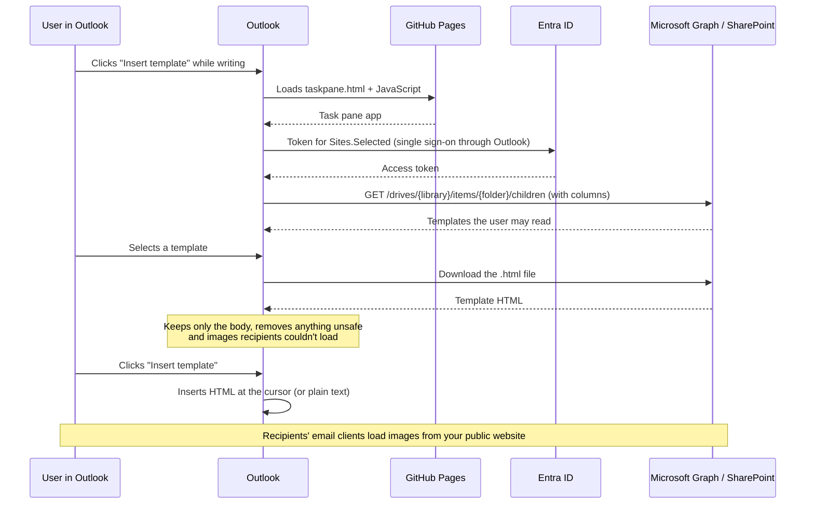

# Outlook Email Templates add-in

An Outlook add-in that lets people insert approved, company-branded email templates into the message they are writing. The templates live in a **SharePoint Online document library**, where authors edit them directly. The add-in reads them through **Microsoft Graph** with the user's own sign-in. The add-in itself (a static web app) is built and hosted by GitHub.

> **New to GitHub?** Start at [Part 4: Working with GitHub](#part-4-working-with-github). If you only need to add or change a template, go to [Part 5: Adding or editing a template](#part-5-adding-or-editing-a-template). Setting up the Entra ID app registration: [docs/app-registration.md](docs/app-registration.md).
>
> **Setting up a new tenant (e.g. production)?** Follow [docs/production-setup.md](docs/production-setup.md): every step from SharePoint and Entra ID to GitHub and Outlook, in order.

## Contents

- [Part 1: What this is](#part-1-what-this-is)
- [Part 2: Repository map](#part-2-repository-map)
- [Part 3: Working on a locked-down corporate PC](#part-3-working-on-a-locked-down-corporate-pc)
- [Part 4: Working with GitHub](#part-4-working-with-github)
- [Part 5: Adding or editing a template](#part-5-adding-or-editing-a-template)
- [Part 6: First-time setup checklist](#part-6-first-time-setup-checklist)
- [Part 7: How the code works](#part-7-how-the-code-works)
- [Part 8: Troubleshooting](#part-8-troubleshooting)
- [Part 9: Optional: running everything on an unrestricted computer](#part-9-optional-running-everything-on-an-unrestricted-computer)

---

## Part 1: What this is

### What the add-in does

- Adds an **Insert template** button to the ribbon when you write a new message, reply or forward, in **classic Outlook for Windows**, **new Outlook** and **Outlook on the web**.
- The button opens a side panel (the *task pane*). In classic Outlook you can pin it so it stays open.
- In the task pane you can:
  - **search** by name, description or keyword;
  - **filter** by category;
  - **preview** a template;
  - **insert** it into the message body: where your cursor is (if you have selected text, the template replaces it), or at the top of the body if the cursor is in To, Cc or Subject.
- If the message is in plain-text format, a text-only version is inserted and you see a notice.

### What it does not do

- It does not set the subject, recipients or attachments.
- It has no placeholders (such as `{{DisplayName}}`) yet.
- It does not show different templates to different groups. Everyone sees every template they can read in SharePoint, grouped by category. (You *can* restrict individual files with SharePoint permissions.)
- It does not support Outlook for Mac or mobile.
- There is no server and no client secret. Sign-in uses the Microsoft 365 account already signed in to Outlook.

### How templates are stored and loaded

- **Templates:** one `.html` file per template in a SharePoint document library (default name **Email Templates**), optionally only in one folder of it (for example the **Email** folder of the site's **Documents** library) and its subfolders. Library columns hold the metadata: **Title** (name), **Template category**, **Template description**, **Template keywords**; all are optional. Authors edit files and columns in SharePoint; changes are live the next time a user opens the task pane.
- **Access:** the add-in signs the user in with **Nested App Authentication** (single sign-on through Outlook) and calls Microsoft Graph with the delegated permission **`Sites.Selected`**. The app can only read sites an admin explicitly granted to it, and never more than the user can read. See [docs/app-registration.md](docs/app-registration.md).
- **Images:** recipients can't open SharePoint files, so template images must be absolute `https://` URLs on a public website (for example your company website or CDN).
- **The add-in itself:** when a change reaches the `main` branch, a GitHub Actions workflow (an automated job that GitHub runs for you) checks and builds the add-in and publishes it to **GitHub Pages**, GitHub's free static website hosting, at `https://<org>.github.io/<repo>/`.

`<org>` is your GitHub organization or user name and `<repo>` is the repository name.

> **Nothing is tied to one tenant.** The tenant ID, app (client) ID, SharePoint site and library name are build settings (GitHub repository variables, or `addin/.env` locally), so the same code works in a test tenant and in production.

### How a request flows



---

## Part 2: Repository map

```
.
├── README.md                     This guide
├── docs/
│   ├── app-registration.md       Entra ID app registration + enterprise app settings
│   ├── deployment.md             Short admin runbook (setup, publishing, admin center)
│   ├── production-setup.md       Full step-by-step setup for a new tenant (production)
│   ├── local-testing.md          Running and testing the add-in on your PC
│   └── publishing-to-github.md   Putting this project on GitHub
├── samples/
│   └── templates/*.html          Sample templates you can upload to SharePoint
├── scripts/
│   ├── Initialize-TemplateLibrary.ps1  Creates the SharePoint library + columns (+ uploads samples)
│   ├── Grant-TemplateSiteAccess.ps1    Grants the app Sites.Selected access to the site
│   └── TemplateLibrary.Common.ps1      Shared helpers for the two scripts
├── tests/
│   └── TemplateLibrary.Tests.ps1 Pester tests for the scripts (Graph calls mocked)
├── addin/                        The Outlook add-in (web app)
│   ├── manifest.json             Unified manifest: tells Outlook about the add-in (default)
│   ├── manifest.xml              Older XML manifest (fallback only)
│   ├── assets/                   Add-in icons (ribbon button, admin center)
│   ├── .env.example              Template for local settings (copy to .env)
│   ├── package.json              JavaScript dependencies and npm commands
│   ├── webpack.config.js         Build settings; the single place URLs and tenant settings come from
│   ├── tsconfig.json             TypeScript compiler settings
│   ├── tsconfig.test.json        TypeScript settings for unit tests
│   ├── jest.config.js            Unit test settings
│   ├── eslint.config.mjs         Code style (lint) rules
│   ├── src/
│   │   ├── globals.d.ts          Declares the build-time constants
│   │   ├── auth/                 auth.html: sign-in redirect page for the popup fallback
│   │   └── taskpane/
│   │       ├── taskpane.html     Page Outlook loads; includes Office.js
│   │       ├── index.tsx         Starts the app when Office is ready
│   │       ├── components/
│   │       │   ├── App.tsx       The whole task pane UI
│   │       │   └── TemplatePreview.tsx  Sandboxed preview frame
│   │       └── lib/
│   │           ├── config.ts         Tenant, app and SharePoint settings
│   │           ├── auth.ts           Sign-in (NAA with popup fallback) and Graph tokens
│   │           ├── sharePoint.ts     Microsoft Graph calls: list and download templates
│   │           ├── templateItems.ts  Turns library items into the template list
│   │           ├── filter.ts         Search and category filter
│   │           ├── templateHtml.ts   Body extraction, sanitizing, URL checks, plain text
│   │           └── outlook.ts        Talks to Outlook (insert at the cursor)
│   └── tests/                    Jest unit tests for the lib/ files
├── .github/workflows/
│   ├── ci.yml                    Checks every pull request
│   └── deploy.yml                Publishes to GitHub Pages after changes to main
├── .gitignore                    Files Git must not store (node_modules, dist, .env, ...)
└── .gitattributes                Line endings and binary file settings
```

Generated or local files are never stored in the repository:

- `addin/node_modules/`: downloaded JavaScript packages;
- `addin/dist/`: the built website;
- `addin/.env`: your local settings.

### The published site

```
https://<org>.github.io/<repo>/
├── taskpane.html, taskpane.<hash>.js   The add-in
├── auth.html, auth.<hash>.js           Sign-in redirect page (popup fallback)
├── assets/                             Icons
└── manifest.json, manifest.xml         Manifests with the real URLs
```

The templates are **not** on this site; they stay in SharePoint.

---

## Part 3: Working on a locked-down corporate PC

This project is set up so that nothing needs to be installed on a restricted PC.

| Task | Where | Tools needed |
| --- | --- | --- |
| Add or edit templates | SharePoint in the browser | None |
| Edit docs and source code | Corporate PC (any text editor, e.g. VS Code) or the GitHub website | None |
| Run tests, lint, build | **GitHub Actions** (GitHub's own computers, called *hosted runners*) | None on your PC |
| Publish to GitHub Pages | **GitHub Actions** | None on your PC |
| App registration, enterprise app, admin consent | Web browser (Entra admin center) | None |
| Create the library, grant site access | Any PC that may run PowerShell + `Microsoft.Graph.Authentication`, or by hand / Graph Explorer | PowerShell module (optional) |
| Upload the manifest to Microsoft 365 | Web browser (admin center) | None |
| Run tests locally or sideload into Outlook for debugging | **Optional**, unrestricted computer only | Node.js, PowerShell 7, Pester |

You never need to run `npm`, build or test commands on the corporate PC. Push your change to a branch, open a pull request, and GitHub runs all the checks for you.

> **About `package-lock.json`:** this file records the exact version of every JavaScript dependency. It can only be created by running `npm install`, so the repository doesn't include one yet. Until it exists, GitHub Actions runs `npm install` and gets the newest compatible versions. When you have an unrestricted computer, create the file once and commit it (see [Part 9](#part-9-optional-running-everything-on-an-unrestricted-computer)). After that, Actions switches to `npm ci` automatically, so builds are repeatable.

---

## Part 4: Working with GitHub

### Terms you'll see

| Term | Meaning |
| --- | --- |
| **Repository (repo)** | The project folder stored on GitHub, with its full history. |
| **Commit** | A saved snapshot of changes, with a message describing them. |
| **Branch** | A separate line of work. `main` is the live branch; you make changes on your own branch. |
| **Pull request (PR)** | A request to merge your branch into `main`. Others review it and the automatic checks run on it. |
| **Merge** | Applying the pull request's changes to `main`. |
| **GitHub Actions** | GitHub's automation. The workflows in `.github/workflows/` define what runs. |
| **Workflow run** | One execution of a workflow. Green tick = passed, red cross = failed. |
| **Artifact** | A file a workflow run produces that you can download (e.g. the manifests). |
| **GitHub Pages** | GitHub's static website hosting, where the add-in is served from. |

### Getting the repository

- **Creating it (admin):** on GitHub, click **+ > New repository**, choose the owner (your organization), a name (this becomes `<repo>` in the URL, so choose carefully; renaming later means new manifests and new redirect URIs in the app registration), and the visibility ([see Part 6](#part-6-first-time-setup-checklist)). Then upload this folder's contents, either by dragging the files onto **Add file > Upload files** on the repository page or with Git from the command line.
- **Receiving access:** an admin adds you under **Settings > Collaborators and teams**. You'll get an email invitation.

### The repository page

- **Code** tab: the files. Click a folder to open it, click a file to view it.
- **Pull requests** tab: open and past change requests.
- **Actions** tab: workflow runs (CI and Deploy) with their logs.
- **Settings** tab (admins only): Pages, branch rules, Actions permissions.
- The branch selector (top left of the file list, usually showing `main`) switches between branches.

### Making a change in the browser (simplest)

Good for editing the code, docs or this README. (Templates are edited in SharePoint, see [Part 5](#part-5-adding-or-editing-a-template).)

1. Open the file on GitHub and click the **pencil icon** (Edit this file). To add a file, open the folder and click **Add file > Create new file** or **Upload files**.
2. Make your change.
3. Click **Commit changes...**.
4. Write a short message, e.g. "Clarify setup steps".
5. Choose **Create a new branch for this commit and start a pull request**. GitHub suggests a branch name; you can keep it.
6. Click **Propose changes**, then **Create pull request**.

If `main` is protected (recommended), GitHub will offer the new-branch option automatically.

### Making a change on your PC with Git (optional)

If Git is already available:

```powershell
git switch -c improve-search           # create and switch to a new branch
# ...edit files...
git add addin/src/taskpane/lib/filter.ts addin/tests/filter.test.ts
git commit -m "Improve search"
git push -u origin improve-search      # upload the branch to GitHub
```

GitHub then shows a **Compare & pull request** button on the repository page.

### Reviewing CI results

1. Open the pull request. At the bottom you'll see the checks: **CI / PowerShell** and **CI / Add-in**.
2. A yellow dot means running, a green tick means passed, a red cross means failed.
3. Click **Details** next to a failed check to open the log. Expand the red step to see the error.

### Fixing failures

Edit the files on the **same branch** (open the file from the pull request's **Files changed** tab, or switch the branch selector to your branch). Commit again. The checks re-run automatically. See [Part 8](#part-8-troubleshooting) for common errors.

### Merging

When the checks are green and a reviewer has approved, click **Merge pull request > Confirm merge**. You can then delete the branch (GitHub offers a button).

### Finding the deployment

1. Open the **Actions** tab and click the **Deploy** workflow on the left.
2. The newest run at the top corresponds to your merge. Wait for the green tick.
3. Open the run. The **deploy** box shows the site link. Downloadable files (the manifests) are under **Artifacts** at the bottom of the run page.
4. The repository's **Environments > github-pages** section (right-hand side of the Code tab) also lists every deployment.

Users see the change within about 10 minutes of the deployment finishing.

### Undoing a change

Open the merged pull request and click **Revert**. This creates a new pull request that undoes the change. Merge it like any other.

---

## Part 5: Adding or editing a template

Templates are managed **only in SharePoint**. No pull request, build or deployment is involved: a change is visible the next time a user opens the task pane.

### The template format

One `.html` file per template in the templates library, or in the configured folder (`SHAREPOINT_FOLDER`) and its subfolders (up to 5 levels deep). Example:

```html
<!DOCTYPE html>
<html lang="en">
<head>
  <meta charset="utf-8">
  <title>Holiday closure</title>
</head>
<body>
  <p style="font-family: Calibri, Arial, sans-serif; font-size: 11pt;">Hello,</p>
  <p style="font-family: Calibri, Arial, sans-serif; font-size: 11pt;">Our offices are closed ...</p>
  <p></p>
</body>
</html>
```

- **Content:** everything inside `<body>` is inserted into the email. The `<head>` is never inserted.
- **Styling:** use inline `style="..."` attributes. `<style>` blocks are removed, because they would change the look of the whole email. Tables work well for layout. Keep it simple, since email clients support far less HTML and CSS than browsers.
- **Images:** must be absolute `https://` URLs on a website **recipients can reach**, such as your company website or CDN. SharePoint URLs don't work: recipients can't sign in to your SharePoint. Images with a relative path (`images/logo.png`), `http://` or a SharePoint link are **removed** by the add-in, so you'll notice them missing in the preview. Always set `alt`, `width` and `height`.
- **Links:** `https://`, `mailto:` and `tel:` links work as normal. Relative links lose their link (the text stays).
- **Not allowed** (removed automatically): `<script>`, event attributes such as `onclick`, `javascript:` links, `<style>` and form elements.

### The library columns (metadata)

| Column | Required | Shown in the add-in as |
| --- | --- | --- |
| **Title** (built-in) | Recommended | The template name. If empty, the file name without `.html` is used. |
| **Template category** | No | Groups templates in the category filter. If empty (or the column doesn't exist), the template appears under **Uncategorized**. |
| **Template description** | No | Shown under the name and searchable. |
| **Template keywords** | No | Extra search words, separated by commas. |

Only `.html` and `.htm` files are listed. Other files in the library (for example a draft `.docx`) are ignored.

The sample files in [samples/templates/](samples/templates/) still contain `<meta name="template-...">` tags. Only `Initialize-TemplateLibrary.ps1 -SampleTemplatesPath` reads those, to fill in the columns when it uploads the samples. The add-in itself only reads the columns.

### Step by step

1. Write the template in any editor (VS Code, Notepad, ...) and save it as `something.html`. Open it in a browser to check it.
2. In SharePoint, open the templates library and drag the file in (or **Upload > Files**). Uploading a file with the same name replaces it and keeps the old version in **Version history**.
3. Fill in **Title** and **Template category** (and optionally description and keywords): select the file, then **Details** (the (i) icon), or **Edit in grid view** for many files.
4. If the library uses **content approval**, approve the file. Until then only authors and approvers see it.
5. Open the add-in in Outlook and check the preview.

To **edit** a template's HTML, download it, change it and upload it again (or use **Open > Open in app** if you have an HTML-capable editor). To **rename** it, change **Title**. To **remove** it, delete the file, or move it out of the library. To **roll back**, use **Version history > Restore**.

To add a **new category**, edit the column (**Library settings > Template category > add a choice**).

### Who can do what

Handled entirely by SharePoint permissions on the site or library:

- **Authors** (edit templates): site **Members** or *Edit/Contribute* on the library.
- **Users** (see templates in the add-in): site **Visitors** or *Read* on the library.
- Individual files can be hidden from some people with item-level permissions; the add-in only lists what the user can read.

---

## Part 6: First-time setup checklist

The short version is in [docs/deployment.md](docs/deployment.md). The order matters: the app registration needs the add-in URL, and the build needs the app registration's IDs.

1. **GitHub repository and Pages.**
   - **GitHub Free:** Pages works only for **public** repositories, so the whole repository, including history, is public. That's fine for this project: it contains no templates and no secrets.
   - **GitHub Team / Enterprise:** a **private** repository can publish a **public** Pages site.
   - **Don't** use Enterprise "private Pages" (visitors must sign in to GitHub). Outlook can't sign in, so the add-in wouldn't load.
   - Turn on Pages: **Settings > Pages > Build and deployment > Source = GitHub Actions**. Note the address `https://<org>.github.io/<repo>/`.
2. **Actions permissions:** **Settings > Actions > General**. Allow Actions for this repository. If your organization only allows selected actions, allow these GitHub-made ones: `actions/checkout`, `actions/setup-node`, `actions/configure-pages`, `actions/upload-artifact`, `actions/upload-pages-artifact`, `actions/deploy-pages`. The workflows request only the permissions they need (`contents: read`, `pages: write`, `id-token: write`), so the default "read repository contents" setting is enough.
3. **SharePoint:** create a site and the templates library with its columns, and set permissions. Run `./scripts/Initialize-TemplateLibrary.ps1 -SiteUrl <site-url>` (add `-SampleTemplatesPath samples/templates` to upload the samples) or create them by hand. Details: [docs/deployment.md, step 2](docs/deployment.md#2-sharepoint-site-and-library).
4. **Entra ID app registration:** follow [docs/app-registration.md](docs/app-registration.md): SPA redirect URIs, delegated `Sites.Selected` with admin consent, the site grant (`./scripts/Grant-TemplateSiteAccess.ps1`), and the enterprise application settings.
5. **Repository variables:** **Settings > Secrets and variables > Actions > Variables**: `AUTH_CLIENT_ID`, `AUTH_TENANT_ID`, `SHAREPOINT_SITE_URL`, `SHAREPOINT_LIBRARY` if the library isn't called *Email Templates*, and `SHAREPOINT_FOLDER` if the templates are in a folder.
6. **Protect `main`:** **Settings > Branches > Add branch protection rule** (or **Rules > Rulesets**) for `main`:
   - **Require a pull request before merging**, with at least one approval;
   - **Require status checks to pass**: choose **PowerShell** and **Add-in**. They only show up in the list after CI has run once, so open a test pull request first.
   You need admin rights on the repository for this. If you don't have them, ask whoever does.
7. **First deployment:** **Actions > Deploy > Run workflow**. When it's green, open `https://<org>.github.io/<repo>/taskpane.html` in a browser. You should see a **Sign in** button; after signing in, the template list.
8. **Upload the manifest (Microsoft 365 admin):**
   1. From the Deploy run, download the **addin-manifests** artifact and unzip it.
   2. In the [Microsoft 365 admin center](https://admin.microsoft.com), go to **Settings > Integrated apps > Upload custom apps**, choose **Office Add-in**, and upload `manifest-unified.zip`. Use `manifest.xml` only if the unified one isn't accepted.
   3. Assign it to a pilot group (the same group as the enterprise app, if assignment is required), accept the permissions and finish.
   4. Allow up to **24 hours** for the button to appear in Outlook.
9. **Before going live, make it yours:** in `addin/manifest.json` and `addin/manifest.xml`, change the `Contoso IT` developer/provider name and, if you want, the display name. Replace the sample icons in `addin/assets/` (same file names and pixel sizes).

> **Add-in ID:** both manifests use the ID `6f1d2c84-3b7a-4e59-9a0d-8c2e5b41f7a3`. If you reuse this project for a second, separate add-in, give it a new GUID (e.g. PowerShell `[guid]::NewGuid()`) in both files.

---

## Part 7: How the code works

### Settings and builds: [webpack.config.js](addin/webpack.config.js)

Every value that differs between tenants or hosting locations is a **build setting**, read from environment variables (GitHub repository variables in the Deploy workflow, or `addin/.env` locally):

| Setting | Used for |
| --- | --- |
| `ADDIN_BASE_URL` | Where the JavaScript files are loaded from (webpack `publicPath`) and every URL in the published `manifest.json` and `manifest.xml`. The source manifests contain `https://localhost:3000/`, which is replaced at build time. The Deploy workflow takes it from your Pages settings unless the repository variable overrides it (e.g. for a custom domain). |
| `AUTH_CLIENT_ID`, `AUTH_TENANT_ID` | The Entra ID app registration used to sign in. |
| `SHAREPOINT_SITE_URL`, `SHAREPOINT_LIBRARY`, `SHAREPOINT_FOLDER` | Where the templates are: site, library (display name such as `Documents`, or URL name such as `Shared Documents`), and an optional folder inside it (e.g. `Email`). |

A production build fails if a setting is missing or malformed. A development build still starts, and the task pane says which settings are missing. The values end up in [config.ts](addin/src/taskpane/lib/config.ts) as constants.

### Sign-in: [auth.ts](addin/src/taskpane/lib/auth.ts)

Uses [MSAL.js](https://github.com/AzureAD/microsoft-authentication-library-for-js) `createNestablePublicClientApplication`:

- **Nested App Authentication (NAA)** when Outlook supports it: the token is issued for the account signed in to Outlook, normally without any prompt.
- Otherwise a standard browser client. If no token can be obtained silently, the task pane shows a **Sign in** button that opens a popup. The popup returns to [auth.html](addin/src/auth/auth.html), which hands the result back to the task pane.

The only scope requested is `https://graph.microsoft.com/Sites.Selected` (delegated). Tokens are cached by MSAL in the browser's local storage.

### Loading the list: [sharePoint.ts](addin/src/taskpane/lib/sharePoint.ts), [templateItems.ts](addin/src/taskpane/lib/templateItems.ts)

`SharePointTemplateStore` makes these Microsoft Graph calls:

1. `GET /sites/{host}:/{site-path}` to find the site id (once per task pane session);
2. `GET /sites/{site-id}/lists` to find the library by display or URL name, then its drive (`.../lists/{list-id}/drive`) and the folder (`/drives/{drive-id}/root:/{SHAREPOINT_FOLDER}`), once;
3. `GET /drives/{drive-id}/items/{folder-id}/children?$expand=listItem($expand=fields(...))` for the files with their columns, following `@odata.nextLink` for large folders and walking into subfolders (up to 5 levels);
4. on selection, `GET /drives/{drive-id}/items/{id}` and a plain download of the file from its short-lived, pre-authenticated `@microsoft.graph.downloadUrl` (no `Authorization` header needed). If the item comes back without that link, the add-in downloads `/drives/{drive-id}/items/{id}/content` with the token instead.

Throttling (HTTP 429/503) is retried with `Retry-After`. Other HTTP errors become readable messages (e.g. 403 explains the `Sites.Selected` grant). `parseTemplateItems` keeps only `.html`/`.htm` files and sorts them by category and name.

### Search and category: [filter.ts](addin/src/taskpane/lib/filter.ts)

Each word you type must appear in the name, description or keywords (case-insensitive). The category list is built from the templates themselves, so a new category appears automatically.

### Preview: [App.tsx](addin/src/taskpane/components/App.tsx), [TemplatePreview.tsx](addin/src/taskpane/components/TemplatePreview.tsx)

When you select a template, its HTML is downloaded and prepared (see below), then shown in an `iframe` with an empty `sandbox` (no scripts, forms or popups) and a script-blocking content security policy.

### Sanitizing: [templateHtml.ts](addin/src/taskpane/lib/templateHtml.ts)

`prepareTemplate` does three things:

1. `extractBody`: keeps only what's inside `<body>`.
2. `sanitizeHtml`: runs [DOMPurify](https://github.com/cure53/DOMPurify), which removes scripts, event handlers, `javascript:` links, `<style>` and form elements.
3. `removeRelativeUrls`: removes images that recipients couldn't load (anything but `https:`, `data:` and `cid:`) and unlinks relative links.

It also creates a plain-text version with `htmlToPlainText`.

Because authors edit templates directly in SharePoint, there is no pre-publish check. The add-in therefore treats every template as untrusted and cleans it every time before showing or inserting it. Who may change templates is controlled by SharePoint permissions.

### Inserting: [outlook.ts](addin/src/taskpane/lib/outlook.ts)

`insertIntoMessage` always inserts into the message **body**, never into To, Cc or Subject:

1. It asks Outlook whether the message is HTML or plain text (`item.body.getTypeAsync`). Plain-text messages get the text version, and the task pane shows a notice.
2. It reads the body, calls `item.body.setSelectedDataAsync(...)` to insert at the cursor (or replace the selection), and reads the body again.
3. If the body didn't change, the cursor was somewhere else (for example in the To field). It then adds the template at the top of the body with `item.body.prependAsync(...)`, above the signature and any quoted reply, and the toast says so.

Success and failure are shown as a toast message at the bottom of the task pane.

### SharePoint setup scripts: [scripts/](scripts/)

- [Initialize-TemplateLibrary.ps1](scripts/Initialize-TemplateLibrary.ps1) creates the library and its columns, and with `-SampleTemplatesPath` uploads templates and fills the columns from their `<meta name="template-...">` tags.
- [Grant-TemplateSiteAccess.ps1](scripts/Grant-TemplateSiteAccess.ps1) grants (or with `-Revoke` removes) the app's `Sites.Selected` access to the site.

Both use `Invoke-MgGraphRequest` from the `Microsoft.Graph.Authentication` module, are safe to run again, and support `-WhatIf`. Their Pester tests mock all Graph calls.

### Where to make common changes

| I want to... | Change |
| --- | --- |
| Add/edit/remove a template | The SharePoint library (no code change) |
| Use another tenant, site or library | Repository variables (or `addin/.env`), then run **Deploy**. No manifest change. |
| Change the ribbon button label or icons | `addin/manifest.json` **and** `addin/manifest.xml`, `addin/assets/`. Re-upload the manifest. |
| Change the task pane layout or text | `addin/src/taskpane/components/App.tsx` |
| Change how search works | `addin/src/taskpane/lib/filter.ts` (+ `addin/tests/filter.test.ts`) |
| Read another library column | `TEMPLATE_FIELDS` and `parseTemplateItems` in `templateItems.ts` (+ the column in `Initialize-TemplateLibrary.ps1`) |
| Allow or forbid more HTML in templates | `sanitizeHtml` / `removeRelativeUrls` in `templateHtml.ts` (+ `addin/tests/templateHtml.test.ts`) |
| Change the requested Graph permission | `GRAPH_SCOPES` in `auth.ts` **and** the app registration's API permissions |
| Change the add-in URL | Repository variable `ADDIN_BASE_URL`, new SPA redirect URIs in the app registration. Re-upload the manifest. |

---

## Part 8: Troubleshooting

### A workflow failed

| Failing step | Usual cause and fix |
| --- | --- |
| **Run Pester tests** | The setup scripts or their tests changed. Look for the red `[-]` lines in the log. |
| **Run PSScriptAnalyzer** | A style or safety rule failed in `scripts/`. The table shows file, line and rule. |
| **Install dependencies** | Usually a temporary npm outage, so re-run the job (**Re-run jobs** at the top right). If it keeps failing, a new dependency version may be incompatible. Commit a `package-lock.json` from a working setup (see Part 3). |
| **Lint and type-check** / **Unit tests** / **Test production build** | A code change broke something. The log shows the file and line. |
| **Build the add-in** (Deploy) with *Invalid add-in settings* | A repository variable (`AUTH_CLIENT_ID`, `AUTH_TENANT_ID`, `SHAREPOINT_SITE_URL`) is missing or malformed. The message names it. Fix it under **Settings > Secrets and variables > Actions > Variables** and re-run. |
| **Validate manifests** | A manifest edit is invalid. Undo the last manifest change or check it against the error message. This step uses a Microsoft validation service, so a temporary outage can also cause it; re-run first. |
| **Read GitHub Pages settings** / **Deploy to GitHub Pages** | Pages isn't enabled with **Source = GitHub Actions**, or the `github-pages` environment has protection rules that block `main`. Check **Settings > Pages** and **Settings > Environments**. |

### Sign-in or access errors in the task pane

See [docs/app-registration.md, Troubleshooting](docs/app-registration.md#7-troubleshooting-sign-in) for every `AADSTS` error code. The most common:

| Message | Fix |
| --- | --- |
| *You don't have access to the templates site* | Grant the app access to the site (`Grant-TemplateSiteAccess.ps1`), and make sure the user can open the site in SharePoint. |
| *Could not find the templates site* | `SHAREPOINT_SITE_URL` is wrong. |
| *The "..." library was not found* | `SHAREPOINT_LIBRARY` doesn't match the library's display name (`Documents`) or URL name (`Shared Documents`). |
| *Could not find the "..." folder* | `SHAREPOINT_FOLDER` doesn't match a folder in the library (e.g. `Email`). |
| `AADSTS50105` | Enterprise app has **Assignment required = Yes** and the user isn't assigned. |
| `AADSTS65001` / *Need admin approval* | Admin consent for `Sites.Selected` is missing. |
| *The add-in was built without these settings* | Repository variables were missing at build time. Add them and run **Deploy**. |

### A template or image is missing

- Is the file an `.html` file in the configured library, and can the user open it in SharePoint? With **content approval**, unapproved files are only visible to authors and approvers.
- No category? It's listed under **Uncategorized**.
- Image missing in the preview: the add-in removes images that aren't absolute `https://` URLs (for example `images/logo.png` or a SharePoint link). Host the image on a public website and use its full URL.
- Image broken in the preview or email even with an `https://` URL: open the URL directly in a private browser window. It must load without signing in.
- Some recipients' email clients block remote images until the reader clicks "show images". That's expected.

### Users still see old content

- Template changes: close and reopen the task pane (it loads the list when it opens). In classic Outlook, unpin it and open it again.
- Add-in code changes: wait about 10 minutes after the Deploy run turns green (GitHub Pages caching), then reopen the task pane.

### The button doesn't appear in Outlook

- New deployments and manifest changes can take **up to 24 hours**. Restart Outlook.
- Check that the user (or their group) is assigned in **Integrated apps**.
- The button only appears while **writing** a message (new, reply or forward), not when reading.
- In classic Outlook, the button may be in the **Message** tab or under **Apps** / the "..." overflow menu, depending on the ribbon layout.
- Classic Outlook needs Microsoft 365 / a recent version (Mailbox requirement set 1.5 and the WebView2 browser engine).

### Differences between Outlook versions

- **Sign-in:** new Outlook, Outlook on the web and current classic Outlook builds support single sign-on (NAA), so users see no prompt. Older classic Outlook builds show a **Sign in** button and a popup.
- **Pinning** the task pane works in classic Outlook. Other clients may close the pane when you switch messages.
- **Plain-text messages:** formatting and images aren't inserted, by design.
- Exact rendering of inserted HTML differs slightly between clients, because each mail editor cleans HTML in its own way. Keep templates simple and test them in each client.

---

## Part 9: Optional: running everything on an unrestricted computer

**None of this is required.** GitHub Actions already runs all these checks. Use this section only on a computer where you're allowed to install software.

Requirements: [Node.js](https://nodejs.org) 22 LTS, [PowerShell 7](https://aka.ms/powershell), Git, and a Microsoft 365 account (a test tenant is fine) for sign-in and sideloading.

```powershell
# Pester and PSScriptAnalyzer (Windows ships an old Pester 3; this installs 5+)
Install-Module Pester -MinimumVersion 5.5.0 -Scope CurrentUser -Force -SkipPublisherCheck
Install-Module PSScriptAnalyzer -Scope CurrentUser -Force

# PowerShell tests (from the repository root; Graph calls are mocked)
Invoke-Pester tests -Output Detailed
Invoke-ScriptAnalyzer -Path scripts -Recurse -Severity Warning, Error

# Add-in checks
cd addin
npm install        # first time: creates package-lock.json, so commit it!
npm run lint
npm test
npm run validate
```

After the first `npm install`, commit `addin/package-lock.json`. From then on, use `npm ci`, and GitHub Actions will too.

### Sideloading into Outlook for testing

For a step-by-step guide, including testing when sideloading is blocked, see [docs/local-testing.md](docs/local-testing.md). The app registration needs the development redirect URIs `brk-multihub://localhost:3000` and `https://localhost:3000/auth.html`.

```powershell
cd addin
Copy-Item .env.example .env   # once: fill in your tenant, app and SharePoint settings
npm run dev-server   # first run asks to trust a local HTTPS certificate
npm start            # in a second terminal: sideloads manifest.json into Outlook
# npm run start:xml  # alternative: sideload the XML manifest
npm stop             # remove the sideloaded add-in when done
```

`addin/.env` is ignored by Git, so it won't be committed by accident.

### Manual test matrix

Test in **classic Outlook**, **new Outlook** and **Outlook on the web**:

- [ ] Button appears on a new message, a reply and a forward.
- [ ] Templates load without a sign-in prompt (NAA); on clients without NAA, **Sign in** works.
- [ ] A user who is not allowed (no site access, or not assigned to the enterprise app) sees a clear error.
- [ ] Search and category filter work; empty and error states show correctly.
- [ ] A template edited in SharePoint shows the change after reopening the task pane.
- [ ] Inserting into an HTML message, at the start, middle (cursor inside existing text) and end.
- [ ] With the cursor in To, Cc or Subject, the template is added at the top of the body (above the signature).
- [ ] Inserting into a plain-text message shows the notice and inserts readable text.
- [ ] Images show in the sent email for the recipient.
- [ ] Task pane stays pinned in classic Outlook when moving between drafts.
