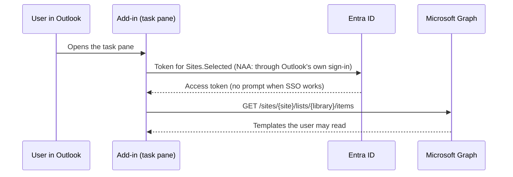

# Entra ID app registration and enterprise application

The add-in reads templates from SharePoint Online through Microsoft Graph, on behalf of the signed-in user. For that it needs **one app registration** in Microsoft Entra ID. This guide covers everything to set up, in order:

1. [Create the app registration](#1-create-the-app-registration)
2. [Add the redirect URIs](#2-add-the-redirect-uris)
3. [Add the Graph permission and grant admin consent](#3-add-the-graph-permission-and-grant-admin-consent)
4. [Grant the app access to the templates site (Sites.Selected)](#4-grant-the-app-access-to-the-templates-site-sitesselected)
5. [Configure the enterprise application](#5-configure-the-enterprise-application)
6. [Give the values to the build](#6-give-the-values-to-the-build)
7. [Troubleshooting sign-in](#7-troubleshooting-sign-in)

Placeholders used below:

| Placeholder | Example | Meaning |
| --- | --- | --- |
| `<addin-host>` | `contoso.github.io` | Host name the add-in is served from (no path, no `https://`) |
| `<addin-url>` | `https://contoso.github.io/outlook-template-addin/` | Full URL of the published add-in folder, ending in `/` |
| `<site-url>` | `https://contoso.sharepoint.com/sites/EmailTemplates` | SharePoint site with the templates library |
| `<client-id>` | `0d3c...` | Application (client) ID of the app registration |
| `<tenant-id>` | `72f9...` | Directory (tenant) ID |

## How sign-in works



- **Nested App Authentication (NAA)** is Microsoft's recommended single sign-on for Office add-ins. The add-in asks Outlook for a token for the account already signed in to Outlook, so users normally see no prompt at all. It works in new Outlook, Outlook on the web and current builds of classic Outlook for Windows.
- On clients without NAA, MSAL falls back to a **sign-in popup**. The task pane shows a **Sign in** button for this.
- There is **no client secret and no server**. The add-in is a public single-page app; the client ID and tenant ID are not secrets.
- The token is **delegated**: the add-in can never read more than the user can. With `Sites.Selected`, it's further limited to sites an admin granted to the app (step 4).

Roles you need: **Application Administrator** or **Cloud Application Administrator** for steps 1-3 and 5, **Global Administrator** or **Privileged Role Administrator** for admin consent to Microsoft Graph in step 3, and **SharePoint Administrator** (or Global Administrator) for step 4.

## 1. Create the app registration

1. Open the [Microsoft Entra admin center](https://entra.microsoft.com) > **Entra ID** > **App registrations** > **New registration**.
2. **Name:** for example `Outlook Email Templates add-in`. Users may see it in consent and sign-in screens.
3. **Supported account types:** **Accounts in this organizational directory only (Single tenant)**.
4. **Redirect URI:** leave empty for now (step 2 adds them).
5. Click **Register**.
6. On the **Overview** page, copy the **Application (client) ID** (`<client-id>`) and the **Directory (tenant) ID** (`<tenant-id>`).

Optional but recommended: under **Branding & properties**, add a logo and your publisher details; under **Owners**, add a second person so the app isn't orphaned.

## 2. Add the redirect URIs

Open **Authentication** > **Add a platform** > **Single-page application** and add these URIs. All of them are type **Single-page application (SPA)**; NAA only works with SPA redirect URIs.

| Redirect URI | Purpose |
| --- | --- |
| `brk-multihub://<addin-host>` | NAA in production, e.g. `brk-multihub://contoso.github.io`. Host only: no path, no trailing slash. |
| `<addin-url>auth.html` | Popup fallback in production, e.g. `https://contoso.github.io/outlook-template-addin/auth.html` |
| `brk-multihub://localhost:3000` | NAA during local development (optional) |
| `https://localhost:3000/auth.html` | Popup fallback during local development (optional) |

On the same page:

- Leave **Access tokens** and **ID tokens** (implicit grant) **unchecked**. MSAL uses the authorization code flow with PKCE.
- Leave **Allow public client flows** set to **No**.
- Do **not** create a client secret or certificate. The add-in doesn't use one.

If you later move the add-in to a custom domain, add the matching `brk-multihub://` and `.../auth.html` URIs for the new host.

## 3. Add the Graph permission and grant admin consent

1. Open **API permissions** > **Add a permission** > **Microsoft Graph** > **Delegated permissions**.
2. Search for and select **`Sites.Selected`**, then **Add permissions**.
3. Optional: remove the default **User.Read** permission. The add-in doesn't call `/me`. (MSAL always asks for `openid`, `profile` and `offline_access`; these don't need admin consent.)
4. Click **Grant admin consent for <your tenant>** and confirm. The **Status** column should show a green tick for every permission.

`Sites.Selected` requires admin consent. Without it, users would see "Need admin approval" on first use.

> **Why `Sites.Selected` and not `Sites.Read.All`?** `Sites.Read.All` lets the app read *every* site the user can read. `Sites.Selected` gives the app access to **no** site until an admin grants specific sites (next step). If a token ever leaked, it would only expose the templates site.

## 4. Grant the app access to the templates site (Sites.Selected)

This is a SharePoint-level grant on the one site that holds the templates. Until it's done, the add-in gets **HTTP 403** and shows "You don't have access to the templates site".

### Option A: the script in this repository (recommended)

On a computer with PowerShell 7 (or Windows PowerShell 5.1):

```powershell
Install-Module Microsoft.Graph.Authentication -Scope CurrentUser   # once
./scripts/Grant-TemplateSiteAccess.ps1 -SiteUrl <site-url> -ClientId <client-id>
```

It signs you in with the **Microsoft Graph Command Line Tools** app and the scope `Sites.FullControl.All` (only an admin can consent to that), then creates a **read** grant for your app on the site. Running it again is safe. To remove the grant later, add `-Revoke`.

### Option B: Graph Explorer

In [Graph Explorer](https://developer.microsoft.com/graph/graph-explorer), signed in as an admin with `Sites.FullControl.All` consented:

1. `GET https://graph.microsoft.com/v1.0/sites/contoso.sharepoint.com:/sites/EmailTemplates?$select=id` and copy the `id`.
2. `POST https://graph.microsoft.com/v1.0/sites/{id}/permissions` with:

   ```json
   {
     "roles": ["read"],
     "grantedToIdentities": [
       { "application": { "id": "<client-id>", "displayName": "Outlook Email Templates add-in" } }
     ]
   }
   ```

3. Check with `GET https://graph.microsoft.com/v1.0/sites/{id}/permissions`.

### Option C: PnP PowerShell

```powershell
Grant-PnPAzureADAppSitePermission -AppId <client-id> -DisplayName "Outlook Email Templates add-in" -Site <site-url> -Permissions Read
```

### Users need site access too

Delegated `Sites.Selected` is the **intersection** of the app's grant and the user's own permissions. Everyone who uses the add-in must be able to read the library:

- **Readers:** add them (or a group such as *Everyone except external users*) to the site's **Visitors** group, or give them **Read** on the library only.
- **Template authors:** add them to the site's **Members** group, or give them **Edit/Contribute** on the library.

## 5. Configure the enterprise application

Creating the app registration (and granting consent) also creates an **enterprise application** (a *service principal*): the instance of the app in your tenant. Its settings control **who may sign in** to it. Open **Entra ID** > **Enterprise apps** > **All applications**, remove the *Enterprise Applications* filter if needed, and search for the app name.

| Setting | Where | Recommended value | Why |
| --- | --- | --- | --- |
| **Assignment required?** | **Properties** | **Yes** for a pilot, or if only some people should use the add-in. **No** if everyone may use it. | With **Yes**, only users and groups listed under **Users and groups** can get a token. Everyone else gets error `AADSTS50105`. |
| **Users and groups** | **Users and groups** > **Add user/group** | The same pilot group you assign the add-in to in the Microsoft 365 admin center | Only used when assignment is required. Assigning **groups** needs Entra ID P1/P2; on the free tier, assign individual users. Nested groups aren't supported. |
| **Visible to users?** | **Properties** | **No** | The app only works inside Outlook, so a My Apps tile would be a dead link. |
| **Enabled for users to sign-in?** | **Properties** | **Yes** | **No** blocks the add-in for everyone: a quick kill switch. |
| **Permissions** | **Security** > **Permissions** | Shows **Sites.Selected** under *Admin consent* | Confirms step 3 worked. **Review permissions** lets you revoke consent. |
| **Owners** | **Owners** | At least two people | Owners can manage the app without being admins. |
| **Conditional Access** | **Security** > **Conditional Access** | Usually nothing extra | Policies that target *All resources* (MFA, compliant device, ...) already apply. With NAA, Outlook's sign-in normally already satisfies them. |
| **Sign-in logs** | **Activity** > **Sign-in logs** | - | First place to look when a user can't load templates. |

Things to keep aligned:

- The **add-in deployment** in the Microsoft 365 admin center (*Integrated apps*) decides who sees the **button** in Outlook. The **enterprise app assignment** decides who can **sign in**. If you use both, assign the same group in both places, or users see the button but get a sign-in error.
- If your tenant **blocks user consent** (common), the admin consent from step 3 is enough; users are never asked.
- Don't add certificates or secrets under the enterprise app's **Single sign-on** page. The add-in doesn't use SAML or a secret; leave it on the default.

## 6. Give the values to the build

The add-in reads these settings at **build time**. Nothing tenant-specific is stored in the code, so the same repository works in any tenant.

| Name | Value |
| --- | --- |
| `AUTH_CLIENT_ID` | `<client-id>` |
| `AUTH_TENANT_ID` | `<tenant-id>` |
| `SHAREPOINT_SITE_URL` | `<site-url>` |
| `SHAREPOINT_LIBRARY` | Library display name (optional, default `Email Templates`; a site's default library is `Documents`) |
| `SHAREPOINT_FOLDER` | Folder inside the library, e.g. `Email` (optional; empty = whole library) |

- **GitHub Actions:** repository **Settings** > **Secrets and variables** > **Actions** > **Variables** tab > **New repository variable**, one per row. Then run **Actions** > **Deploy** > **Run workflow**. Use *variables*, not *secrets*: none of these values are secret.
- **Local development:** copy `addin/.env.example` to `addin/.env` and fill it in (see [local-testing.md](local-testing.md)).

A production build fails with a clear message if a value is missing or malformed.

## 7. Troubleshooting sign-in

| What you see | Cause and fix |
| --- | --- |
| `AADSTS50011` redirect URI mismatch | The `brk-multihub://<addin-host>` or `.../auth.html` URI in step 2 doesn't match where the add-in runs. Check spelling, the host, `localhost:3000` for development, and that the platform is **SPA**. |
| `AADSTS65001` / "Need admin approval" | Admin consent for `Sites.Selected` is missing. Repeat step 3. |
| `AADSTS50105` "not assigned to a role" | **Assignment required** is **Yes** and the user isn't assigned. Add them (or their group) under the enterprise app's **Users and groups**. |
| `AADSTS700016` application not found | Wrong `AUTH_CLIENT_ID` or `AUTH_TENANT_ID`, or the app is in another tenant. |
| `AADSTS7000218` / client secret expected | **Allow public client flows** was changed or the redirect URIs were added under **Web** instead of **SPA**. |
| Task pane: "You don't have access to the templates site" (HTTP 403) | The site grant in step 4 is missing, or the user can't read the site. Check both. |
| Task pane: "Could not find the templates site" (HTTP 404) | `SHAREPOINT_SITE_URL` is wrong. |
| Task pane: "The ... library was not found" | `SHAREPOINT_LIBRARY` doesn't match the library's display name (`Documents`) or URL name (`Shared Documents`). |
| Task pane: "Could not find the ... folder" | `SHAREPOINT_FOLDER` doesn't match a folder in the library. |
| The **Sign in** button appears every time | The client doesn't support NAA and the browser blocks storage for the popup. Update Outlook; in Outlook on the web, allow pop-ups and third-party storage for the add-in's host. |
| Popup opens and closes, nothing happens | `<addin-url>auth.html` is missing from the SPA redirect URIs, or the page wasn't deployed. Open it in a browser: it should say "Signing in...". |
