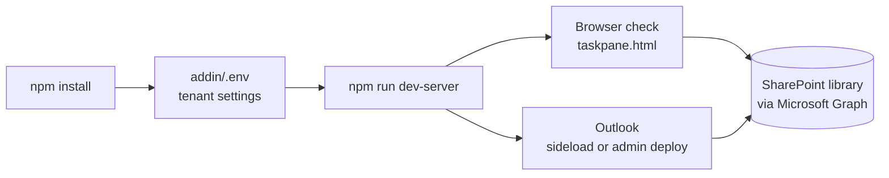

# Testing the add-in locally

This guide runs the add-in from your own PC (`https://localhost:3000/`) so you can test changes before they are deployed. Each step explains what the command does and how to tell that it worked.

- [Before you start](#before-you-start)
- [Step 1: Install the dependencies](#step-1-install-the-dependencies)
- [Step 2: Configure the local settings](#step-2-configure-the-local-settings)
- [Step 3: Start the dev server](#step-3-start-the-dev-server)
- [Step 4: Check the dev server in a browser](#step-4-check-the-dev-server-in-a-browser)
- [Step 5: Test the task pane in the browser](#step-5-test-the-task-pane-in-the-browser)
- [Step 6: Run the automated checks](#step-6-run-the-automated-checks)
- [Step 7: Test inside Outlook](#step-7-test-inside-outlook)
- [Step 8: Stop and clean up](#step-8-stop-and-clean-up)
- [Troubleshooting](#troubleshooting)



## Before you start

You need:

- **Node.js 20.12 or newer.** Check with `node --version`.
- **npm access to a package registry.** On a corporate PC, npm must trust the company's TLS certificates. If `npm view react version` hangs or shows `SELF_SIGNED_CERT_IN_CHAIN`, fix that first.
- **The SharePoint library and app registration** from [deployment.md](deployment.md) steps 2-3, including the **development** redirect URIs `brk-multihub://localhost:3000` and `https://localhost:3000/auth.html` ([app-registration.md](app-registration.md#2-add-the-redirect-uris)). A free Microsoft 365 developer or test tenant is fine.
- **PowerShell 7 with Pester 5+** only if you want to run the script tests.
- **Two terminals**: the dev server keeps one busy for as long as it runs.

Commands marked *(repository root)* run in the repository folder. Commands marked *(addin)* run in its `addin` subfolder.

## Step 1: Install the dependencies

*(addin)*

```powershell
npm install
```

**What it does:** reads `addin/package.json` and downloads everything the add-in needs to build and run (webpack, React, Fluent UI, MSAL, TypeScript, Jest, the Office add-in tools) into `addin/node_modules`. It also creates the small launcher programs in `node_modules/.bin`, such as `webpack`, that the `npm run ...` scripts call.

**When to run it:** the first time, and again whenever `package.json` changes. You don't need it before every test session.

**How to tell it worked:** it ends with `added/changed N packages` and exit code 0, and `Test-Path node_modules\.bin\webpack.cmd` returns `True`.

> On a corporate PC this can take several minutes with no output while files are unpacked and scanned by antivirus. To see whether it's still working, check that the newest file in `%LOCALAPPDATA%\npm-cache\_logs` keeps getting updated.

> **Common error:** `'webpack' is not recognized as an internal or external command` means this step didn't finish. Run `npm install` again.

> **Native build errors (`gyp ERR!`, `keytar`):** an optional native dependency of the Office debugging tools couldn't compile, typically on a locked-down PC or a very new Node.js version. Lint, tests and builds don't need it: run `npm install --ignore-scripts`. Use Node.js 22 LTS if you need `npm start` sideloading.

## Step 2: Configure the local settings

*(addin)*

```powershell
Copy-Item .env.example .env
notepad .env
```

**What it does:** `addin/.env` tells the build which tenant, app registration and SharePoint library to use:

| Setting | Where to find it |
| --- | --- |
| `AUTH_CLIENT_ID` | Entra ID > App registrations > your app > **Application (client) ID** |
| `AUTH_TENANT_ID` | Same page, **Directory (tenant) ID** |
| `SHAREPOINT_SITE_URL` | The site's address, e.g. `https://contoso.sharepoint.com/sites/EmailTemplates` |
| `SHAREPOINT_LIBRARY` | The library's display name (default `Email Templates`; a site's default library is `Documents`) |
| `SHAREPOINT_FOLDER` | Optional folder inside the library, e.g. `Email` (subfolders are included) |

`addin/.env` is in `.gitignore`. Real environment variables win over the file, so you can also set them in the terminal instead (`$env:AUTH_CLIENT_ID = '...'`).

**When to run it:** once. Restart the dev server after changing `.env`.

**How to tell it worked:** the dev server in Step 3 doesn't print *"Add-in settings are incomplete"*. With missing settings the development build still starts, but the task pane only shows which settings are missing.

## Step 3: Start the dev server

*(addin)*, in **terminal 1**

```powershell
npm run dev-server
```

**What it does:** runs `webpack serve --mode development`, which:

1. **Creates and trusts a local HTTPS certificate** (first run only). Outlook only loads add-ins over HTTPS, so `office-addin-dev-certs` creates a "Developer CA for Microsoft Office Add-ins" certificate in `%USERPROFILE%\.office-addin-dev-certs` and adds it to your trusted certificates. Windows may ask you to confirm.
2. **Builds the task pane** from `addin/src` (TypeScript and React) into JavaScript, in memory. Development mode includes source maps, so browser developer tools show your original `.tsx` files.
3. **Serves everything at `https://localhost:3000/`**:

   | URL | Content |
   | --- | --- |
   | `/taskpane.html` | The task pane page Outlook loads |
   | `/auth.html` | Sign-in redirect page for the popup fallback |
   | `/manifest.json`, `/manifest.xml` | The add-in manifests |
   | `/assets/*.png` | Ribbon icons |

   Templates are not served locally: the task pane reads them from SharePoint, exactly like production.

4. **Watches for changes.** When you save a file under `addin/src`, it rebuilds automatically. Reload the task pane to see the change.

**How to tell it worked:** the output ends with `webpack ... compiled successfully`. Leave this terminal open for as long as you test; closing it or pressing `Ctrl+C` stops the add-in.

> Warnings such as `Managed item ...\@fluentui\react-icons isn't a directory` come from webpack's caching and can be ignored.

## Step 4: Check the dev server in a browser

Open these in Edge:

- <https://localhost:3000/taskpane.html>: should load without a certificate warning.
- <https://localhost:3000/auth.html>: should show "Signing in..." (followed by an error, because it wasn't opened by a sign-in; that's fine).

**Why:** this proves that HTTPS and the certificate work before Outlook is involved. If the browser shows a certificate warning, Outlook will refuse to load the add-in too.

## Step 5: Test the task pane in the browser

With <https://localhost:3000/taskpane.html> open, you can test most of the add-in **without Outlook and without sideloading**. Office.js also starts outside Office, so the app loads normally. A normal browser has no NAA, so this also tests the **popup fallback**:

1. The task pane shows **Sign in to see the templates**. Click **Sign in**.
2. A popup asks you to sign in with an account from your tenant. It closes by itself.
3. The template list loads from SharePoint.

What you can test here:

- Sign-in, and the error when you close the popup (*"Sign-in was cancelled."*).
- The template list loads from the SharePoint library.
- Search and the category filter.
- The preview of a selected template.
- The empty state (search for something that doesn't exist).
- Error states: for example a wrong `SHAREPOINT_LIBRARY` in `.env` (restart the dev server), or an account that can't read the site.

What doesn't work here: **Insert**. It needs a message being written in Outlook, so you'll see *"Open a message you are writing, then try again."* That's expected, and it confirms the error message works.

**Tip:** press `F12` to open developer tools. The **Console** tab shows errors, and **Network** shows each request to `graph.microsoft.com` and its status code.

## Step 6: Run the automated checks

*(addin)*, in **terminal 2**

```powershell
npm test
```

**What it does:** runs Jest on the unit tests in `addin/tests`, covering filtering, reading the SharePoint list items, the Graph requests (with a fake `fetch`) and HTML clean-up. No server, tenant or Outlook is needed.

```powershell
npm run lint
```

**What it does:** `tsc --noEmit` type-checks all TypeScript without building, then `eslint .` checks code style and common mistakes.

```powershell
npm run validate
```

**What it does:** checks `manifest.json` and `manifest.xml` against Microsoft's manifest rules, so problems show up before an admin tries to upload them.

*(repository root)*, PowerShell tests for the SharePoint setup scripts (needs Pester 5+; Graph calls are mocked, so no tenant is needed):

```powershell
Invoke-Pester tests -Output Detailed
```

GitHub Actions runs all of these on every push, so running them locally is optional. It's just faster feedback.

## Step 7: Test inside Outlook

This is the only way to test **Insert** into a real message. Keep the dev server from Step 3 running. Pick the option your environment allows.

### Option A: Automatic sideload (if allowed)

*(addin)*, in **terminal 2**

```powershell
npm start          # sideloads manifest.json
npm run start:xml  # or: sideloads manifest.xml
```

**What it does:** `office-addin-debugging` registers the local manifest with your Outlook profile, so the add-in appears on the ribbon. It only works if your organization allows custom add-ins.

### Option B: Manual sideload (if allowed)

In Outlook on the web or new Outlook, go to <https://aka.ms/olksideload>, then choose **My add-ins > Custom add-ins > Add a custom add-in > Add from file**, and pick `addin/manifest.xml`.

### Option C: Admin deployment to you only (when sideloading is blocked)

Ask a Microsoft 365 admin to upload the manifest in **admin center > Settings > Integrated apps > Upload custom apps** and assign it **only to you**, as described in [deployment.md](deployment.md):

- **The `localhost` manifest** (`addin/manifest.xml`): the add-in loads from your PC, so it only works while your dev server runs. Other users assigned to it would see an error, so assign it to yourself only.
- **The published manifest:** tests the deployed build instead of your local code.

New assignments can take up to 24 hours to appear in Outlook.

### What to test in Outlook

1. Create a new message, then a reply and a forward. The add-in button should appear on the ribbon each time.
2. Open the task pane, pick a template and click **Insert**:
   - in an HTML message: at the start, in the middle of existing text and at the end;
   - in a plain-text message: a notice appears and readable text is inserted.
3. Send the message to yourself and check that the images show for the recipient.
4. In classic Outlook, pin the task pane and switch between drafts. It should stay open.

Repeat in **classic Outlook**, **new Outlook** and **Outlook on the web**. The full checklist is in the README's manual test matrix.

**Debugging inside Outlook:** in Outlook on the web, use the browser's `F12`. In new and classic Outlook, right-click inside the task pane and choose **Inspect**.

## Step 8: Stop and clean up

```powershell
npm stop           # (addin) removes the add-in sideloaded by "npm start"
npm run stop:xml   # (addin) the same for "npm run start:xml"
```

Then press `Ctrl+C` in terminal 1 to stop the dev server. The next `npm run dev-server` starts quickly because the certificate already exists.

If you want to remove the developer certificate entirely:

```powershell
npx office-addin-dev-certs uninstall
```

## Troubleshooting

| Symptom | Cause and fix |
| --- | --- |
| `'webpack' is not recognized` | Dependencies are missing or only partly installed. Run `npm install` in `addin`. |
| `npm install` seems to hang | Usually a certificate problem, or just slow unpacking. Check the npm log in `%LOCALAPPDATA%\npm-cache\_logs`. |
| `Could not read package.json` | You're in the wrong folder. npm commands run in `addin`. |
| `EADDRINUSE ... 3000` | A dev server is already running. Stop it with `Ctrl+C`, or close the old terminal. |
| Certificate warning at `https://localhost:3000` | Run `npx office-addin-dev-certs install`, then restart the dev server and the browser. |
| Task pane shows "built without these settings" | `addin/.env` is missing or incomplete. Repeat Step 2 and restart the dev server. |
| Sign-in error `AADSTS50011` (redirect URI) | Add `https://localhost:3000/auth.html` and `brk-multihub://localhost:3000` as **SPA** redirect URIs. See [app-registration.md](app-registration.md#7-troubleshooting-sign-in) for other `AADSTS` codes. |
| *"You don't have access to the templates site"* | The app has no `Sites.Selected` grant on the site, or your account can't read it. See [app-registration.md](app-registration.md#4-grant-the-app-access-to-the-templates-site-sitesselected). |
| Task pane shows an empty list | The library has no `.html` files, or you can't see them (content approval: drafts are only visible to authors and approvers). |
| A template's image is missing | Images must be absolute `https://` URLs; relative paths are removed because recipients couldn't load them. |
| Code change doesn't appear | Wait for `compiled successfully` in terminal 1, then reload the task pane. |
| Add-in button missing in Outlook | Custom add-ins may be blocked. Use Step 5 for the UI, and Option C for Outlook. |
