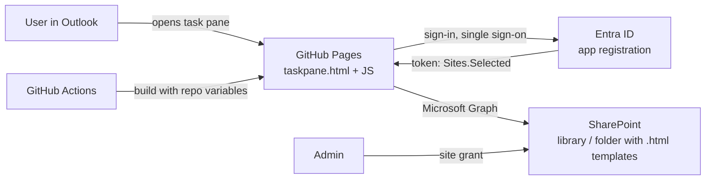

# Production setup guide (end to end)

This guide lists **every** step to set up the Outlook Email Templates add-in in a new Microsoft 365 tenant, from an empty tenant and an empty GitHub repository to users inserting templates in Outlook. It was written while setting up the test tenant, so it includes the details that were easy to miss there.

Do the parts **in order**: each part needs values from the earlier ones.

| Part | What | Who | Time |
| --- | --- | --- | --- |
| [0](#part-0-prepare-and-collect-values) | Decide names, collect values | You | 10 min |
| [1](#part-1-sharepoint-site-library-and-folder) | SharePoint site, library, folder, permissions | Site owner / SharePoint admin | 15 min |
| [2](#part-2-entra-id-app-registration) | Entra ID app registration | Application Administrator | 10 min |
| [3](#part-3-admin-consent-for-microsoft-graph) | Admin consent for Graph | Global Administrator or Privileged Role Administrator | 2 min |
| [4](#part-4-grant-the-app-access-to-the-site-sitesselected) | Grant the app access to the site | Global Administrator or SharePoint Administrator | 5 min |
| [5](#part-5-enterprise-application-settings) | Enterprise application settings | Application Administrator | 5 min |
| [6](#part-6-github-repository) | GitHub repository and code | GitHub org owner / repo admin | 15 min |
| [7](#part-7-github-pages-actions-and-variables) | GitHub Pages, Actions, variables | Repo admin | 10 min |
| [8](#part-8-first-deployment-and-checks) | First deployment and browser checks | You | 10 min |
| [9](#part-9-install-the-add-in-in-outlook) | Install the add-in for users | Exchange / Global Administrator | 10 min + up to 24 h |
| [10](#part-10-after-go-live) | Templates, updates, maintenance | Template authors / IT | ongoing |

Troubleshooting for every part is at the end: [Troubleshooting](#troubleshooting).

---

## How the pieces fit together



- **GitHub** builds the add-in and hosts it on GitHub Pages. It never contains your templates.
- **SharePoint** holds the templates (`.html` files) and who may read or edit them.
- **Entra ID** lets the add-in get a token for Microsoft Graph with the delegated permission **Sites.Selected**: the app can read only sites an admin explicitly granted, and never more than the signed-in user can read.
- **Microsoft 365 admin center** deploys the add-in (the manifest) to users.

---

## Part 0: Prepare and collect values

### 0.1 Decide these names now

Changing them later means new manifests, new redirect URIs or a new build, so choose carefully.

| Item | Test tenant example | Production (fill in) |
| --- | --- | --- |
| GitHub owner (user or organization) | `lachvit` | |
| Repository name | `outlook-template-addin` | |
| Add-in URL (`<addin-url>`) | `https://lachvit.github.io/outlook-template-addin/` | |
| Add-in host (`<addin-host>`) | `lachvit.github.io` | |
| SharePoint site URL (`<site-url>`) | `https://lachvit.sharepoint.com/sites/OfficeTemplateLibrary` | |
| Library | `Documents` | |
| Folder inside the library | `Email` | |
| App registration name | `Outlook Email Templates add-in` | |
| Application (client) ID (`<client-id>`) | *from Part 2* | |
| Directory (tenant) ID (`<tenant-id>`) | *from Part 2* | |
| Pilot group | *(none in test)* | |

The add-in URL is `https://<owner>.github.io/<repo>/` unless you use a custom domain (see [Part 7.5](#75-optional-custom-domain)).

### 0.2 Check these before you start

- [ ] **Company approval.** Hosting the add-in on GitHub Pages (a public website) and registering an app in Entra ID may need approval from security/architecture. The add-in code contains no secrets and no templates, but the code is public if the repository is public.
- [ ] **GitHub plan and Pages availability.**
  - GitHub Free: the repository must be **public** for Pages.
  - GitHub Team / Enterprise Cloud: a **private** repository can publish a **public** Pages site.
  - Do **not** use "private Pages" (visitors must sign in to GitHub): Outlook can't sign in, so the add-in wouldn't load.
  - If your company uses **GitHub Enterprise Cloud with data residency (`*.ghe.com`)** or **GitHub Enterprise Server**, check that GitHub Pages is available and reachable from the internet. If not, host the built `addin/dist` folder on another static HTTPS host (for example Azure Static Web Apps); everything else in this guide stays the same, only `ADDIN_BASE_URL` and the redirect URIs change.
- [ ] **Template images** must be on a public `https://` website (company website or CDN). Recipients can't open SharePoint links; the add-in removes images that aren't absolute `https://` URLs.
- [ ] **Admin roles available** (see the table at the top). One person with Global Administrator can do everything in Microsoft 365.
- [ ] **A computer that may run PowerShell** with the `Microsoft.Graph.Authentication` module, for Part 4 (or use Graph Explorer in a browser instead).

### 0.3 Add-in ID for production

Both manifests (`addin/manifest.json`, `addin/manifest.xml`) contain the add-in ID `6f1d2c84-3b7a-4e59-9a0d-8c2e5b41f7a3`. Give production its **own** ID so test and production can never be confused (for example if both are ever uploaded to the same tenant):

```powershell
[guid]::NewGuid()
```

Replace the ID in **both** files (`"id"` in `manifest.json`, `<Id>` in `manifest.xml`). Also change `Contoso IT` (developer/provider name) and, if you want, the display name, and replace the icons in `addin/assets/` (same file names and pixel sizes).

---

## Part 1: SharePoint site, library and folder

### 1.1 Site

Use an existing site or create one: **SharePoint start page > + Create site > Team site** (or Communication site). Note the site URL, for example `https://contoso.sharepoint.com/sites/OfficeTemplateLibrary`.

> The **site URL** is only the part up to the site name. Don't copy the long browser address of a library view (`.../Shared%20Documents/Forms/AllItems.aspx?id=...`).

### 1.2 Library and folder

Two layouts work:

| Layout | Settings | When |
| --- | --- | --- |
| **Folder in the default library** (used in test) | `SHAREPOINT_LIBRARY` = `Documents`, `SHAREPOINT_FOLDER` = `Email` | The site already has other documents. |
| **Dedicated library** | `SHAREPOINT_LIBRARY` = `Email Templates`, `SHAREPOINT_FOLDER` empty | The site is only for templates. |

- The default library's **display name** is `Documents`; its **URL name** is `Shared Documents` (seen in the browser address). Either works for `SHAREPOINT_LIBRARY`. In non-English sites the display name is translated, so `Shared Documents` is the safer choice there.
- Subfolders of the folder are included (up to 5 levels), so you can organize templates in subfolders.
- Only `.html` and `.htm` files are shown; other files are ignored.

### 1.3 Metadata columns (recommended)

Without these columns the add-in still works: the name comes from **Title** (or the file name) and everything appears under **Uncategorized**. To add the columns:

**With the script** (needs `Microsoft.Graph.Authentication`, site owner or SharePoint admin):

```powershell
Install-Module Microsoft.Graph.Authentication -Scope CurrentUser   # once
./scripts/Initialize-TemplateLibrary.ps1 -SiteUrl <site-url> -LibraryName Documents
# dedicated library instead (creates it if missing):
./scripts/Initialize-TemplateLibrary.ps1 -SiteUrl <site-url> -LibraryName "Email Templates"
# optionally upload the sample templates into the folder:
./scripts/Initialize-TemplateLibrary.ps1 -SiteUrl <site-url> -LibraryName Documents -FolderPath Email -SampleTemplatesPath samples/templates
```

The script asks you to sign in (scope `Sites.Manage.All`; consent as admin if prompted). It's safe to run again; add `-WhatIf` to preview.

**By hand:** in the library, **+ Add column**. The *internal* name matters, so create each column with exactly this name first; you can rename the display name afterwards.

| Internal name | Type | Shown in the add-in as |
| --- | --- | --- |
| `TemplateCategory` | Choice (e.g. General, HR, Sales) | Category filter |
| `TemplateDescription` | Multiple lines of text (plain) | Text under the name; searchable |
| `TemplateKeywords` | Single line of text | Extra search words, comma-separated |

The built-in **Title** column is the template name. Graph-created columns aren't in the default view: **+ Add column > Show/hide columns** to show them.

### 1.4 Permissions

| Who | Needs | How |
| --- | --- | --- |
| Everyone who uses the add-in | **Read** on the library/folder | Site **Visitors** group, e.g. add *Everyone except external users* or a security group |
| Template authors | **Edit** | Site **Members** group |

The add-in shows only what the signed-in user can read.

### 1.5 Recommended library settings

**Library settings > Versioning settings**:
- Keep **version history** on, so a template can be restored.
- Optional: **Require content approval** so new or changed templates are only visible after approval (readers see only approved versions).

### 1.6 Upload the first template

Drag an `.html` file into the folder. Fill in **Title** and the template columns (select the file > **Details** pane, or **Edit in grid view**). Template rules are in [README Part 5](../README.md#part-5-adding-or-editing-a-template).

---

## Part 2: Entra ID app registration

Portal: [Microsoft Entra admin center](https://entra.microsoft.com) > **Entra ID** > **App registrations**.

### 2.1 Register

1. **+ New registration**.
2. **Name:** `Outlook Email Templates add-in` (users may see it in sign-in screens).
3. **Supported account types:** **Accounts in this organizational directory only (Single tenant)**.
4. **Redirect URI:** leave empty (added in 2.2).
5. **Register**.
6. On **Overview**, copy **Application (client) ID** and **Directory (tenant) ID** into your table from Part 0.

### 2.2 Redirect URIs (Authentication)

Open **Authentication**. The new "Authentication (Preview)" page adds **one URI at a time**.

1. **Add Redirect URI** > **Single-page application**.
2. In the panel:

   | Field | Value |
   | --- | --- |
   | **Redirect URI** | `brk-multihub://<addin-host>` (e.g. `brk-multihub://contoso.github.io`) |
   | **Front-channel logout URL** | *leave empty* |
   | **Access tokens (implicit)** | *unchecked* |
   | **ID tokens (implicit and hybrid)** | *unchecked* |

3. **Configure**.
4. Repeat **Add Redirect URI > Single-page application** for each remaining URI:

| Redirect URI | Purpose | Production |
| --- | --- | --- |
| `brk-multihub://<addin-host>` | Single sign-on inside Outlook (Nested App Authentication) | **Required** |
| `<addin-url>auth.html` | Sign-in popup fallback | **Required** |
| `brk-multihub://localhost:3000` | Local development | Usually leave out in production |
| `https://localhost:3000/auth.html` | Local development | Usually leave out in production |

Rules:
- All must be type **Single-page application**. If one appears under **Web**, delete it and add it again as SPA.
- `brk-multihub://` takes the **host only**: no path, no trailing slash.
- `auth.html` must be the **exact** published address, e.g. `https://contoso.github.io/outlook-template-addin/auth.html`.

Expected result on **Redirect URI configuration**: two (or four) rows, all *Single-page application*.

If the new page doesn't accept `brk-multihub://`, click **To switch to the old experience, please click here** and use **Add a platform > Single-page application**.

### 2.3 Settings tab

| Setting | Value |
| --- | --- |
| Access tokens / ID tokens | unchecked |
| Front-channel logout URL | empty |
| **Allow public client flows** | **Disabled** |
| App instance property lock | leave as is |

### 2.4 Supported accounts tab

Must say **Single tenant** (this organizational directory only).

### 2.5 Don't create

- No **client secret** or **certificate**. The add-in is a public single-page app and doesn't use them.
- Nothing under **Expose an API**.

### 2.6 Recommended

- **Owners:** add at least two people.
- **Branding & properties:** logo, publisher domain, support URL.

---

## Part 3: Admin consent for Microsoft Graph

On the app registration > **API permissions**:

1. **+ Add a permission > Microsoft Graph > Delegated permissions**.
2. Search **`Sites.Selected`**, tick it, **Add permissions**.
3. Optional: remove **User.Read** (**...** > **Remove permission**); the add-in doesn't use it.
4. **Grant admin consent for <tenant>** > **Yes**.

Expected result: one row **Microsoft Graph > Sites.Selected | Delegated | Granted for <tenant>** with a green tick.

> **Why Sites.Selected?** With `Sites.Read.All` the app could read every site the user can read. With `Sites.Selected` it can read **no** site until Part 4 grants one.

---

## Part 4: Grant the app access to the site (Sites.Selected)

This is a SharePoint-level grant on the templates site. Without it, the add-in shows *"You don't have access to the templates site"*.

Requires an account that can consent to **Sites.FullControl.All** for the signing-in tool (Global Administrator; in many tenants also SharePoint Administrator once the tool is consented).

### Option A: Script (recommended)

```powershell
Install-Module Microsoft.Graph.Authentication -Scope CurrentUser   # once
Set-ExecutionPolicy -Scope Process Bypass                          # only if scripts are blocked
./scripts/Grant-TemplateSiteAccess.ps1 -SiteUrl <site-url> -ClientId <client-id> -TenantId <tenant-id>
```

- Signs in with the **Microsoft Graph Command Line Tools** app and asks for `Sites.FullControl.All`. Accept the consent (tick *Consent on behalf of your organization* if shown).
- Creates a **read** grant for your app on the site. Safe to run again. `-Revoke` removes it.

Expected last line:

```
Granted 'read' access on <site-url> to app <client-id> (Outlook Email Templates add-in).
```

or, when already done: `The app <client-id> already has 'read' access to <site-url>. Nothing to do.`

### Option B: Graph Explorer (browser only)

In [Graph Explorer](https://developer.microsoft.com/graph/graph-explorer), signed in as admin, **Modify permissions** > consent to `Sites.FullControl.All`, then:

1. `GET https://graph.microsoft.com/v1.0/sites/<tenant>.sharepoint.com:/sites/<SiteName>?$select=id` and copy `id`.
2. `POST https://graph.microsoft.com/v1.0/sites/{id}/permissions` with body:

   ```json
   {
     "roles": ["read"],
     "grantedToIdentities": [
       { "application": { "id": "<client-id>", "displayName": "Outlook Email Templates add-in" } }
     ]
   }
   ```

   `201 Created` means it worked.

### Verify

In the same PowerShell window after Option A:

```powershell
$site  = Invoke-MgGraphRequest GET "https://graph.microsoft.com/v1.0/sites/<tenant>.sharepoint.com:/sites/<SiteName>?`$select=id"
$perms = Invoke-MgGraphRequest GET "https://graph.microsoft.com/v1.0/sites/$($site.id)/permissions"
$perms.value | ForEach-Object {
    $app = ($_.grantedToIdentitiesV2 + $_.grantedToIdentities | Where-Object { $_ } | Select-Object -First 1).application
    [pscustomobject]@{ Roles = $_.roles -join ','; AppId = $app.id; Name = $app.displayName }
}
```

You should see a row with your `<client-id>`. (`Roles` may be empty in this list view; the row itself is what matters.)

The real test is Part 8: the template list loads.

---

## Part 5: Enterprise application settings

**Entra ID > Enterprise apps > All applications** (remove the *Application type* filter if needed) > your app.

| Setting | Where | Production value |
| --- | --- | --- |
| **Assignment required?** | Properties | **Yes** to limit who can sign in (pilot first); **No** for everyone |
| **Users and groups** | Users and groups | The **same** group you assign the add-in to in Part 9. Groups need Entra ID P1/P2; nested groups aren't supported. |
| **Visible to users?** | Properties | **No** (the app only works inside Outlook) |
| **Enabled for users to sign-in?** | Properties | **Yes** (setting **No** is a quick kill switch) |
| **Permissions** | Security > Permissions | Shows **Sites.Selected** under Admin consent |
| **Owners** | Owners | At least two people |
| **Conditional Access** | Security > Conditional Access | Usually nothing extra; tenant-wide policies (MFA, compliant device) already apply |

Keep the two assignments aligned: the **admin center deployment** decides who sees the **button**; the **enterprise app assignment** decides who can **sign in**.

---

## Part 6: GitHub repository

### 6.1 Create the repository

GitHub > **+ > New repository**:
- **Owner:** your organization (production) or user.
- **Name:** from Part 0. It becomes part of the add-in URL.
- **Visibility:** see [0.2](#02-check-these-before-you-start).
- **Don't** add a README, .gitignore or license (the repository must be empty).

### 6.2 Prepare the files

Copy the project **without** `addin/node_modules/`, `addin/dist/`, `addin/.env`.

Check `.gitignore`: it must **not** contain `docs/` (otherwise the guides aren't uploaded). It should contain `node_modules/`, `addin/dist/` and `addin/.env`.

Check that these exist (the dot-folders are easy to lose):

```
.github/workflows/ci.yml
.github/workflows/deploy.yml
.github/dependabot.yml
.gitignore, .gitattributes
README.md, docs/, samples/, scripts/, tests/
addin/ (src, tests, assets, manifest.json, manifest.xml, package.json, .env.example, webpack.config.js, tsconfig*.json, jest.config.js, eslint.config.mjs)
```

### 6.3 Git identity for this repository only

If the same PC also uses a work GitHub account, set the identity **per repository** (without `--global`):

```powershell
cd <project folder>
git config user.name "Your Name"
git config user.email "<id>+<user>@users.noreply.github.com"   # or the address your organization requires
```

### 6.4 Authentication

Pick what works on your PC:

**A. Git Credential Manager (browser sign-in, included in Git for Windows)**

```powershell
git config --global credential.helper            # should print: manager
git remote set-url origin https://<github-user>@github.com/<owner>/<repo>.git   # pins the account for this repo
```

On the first push choose **Sign in with your browser**.

**B. Fine-grained personal access token** (when browser sign-in isn't possible)

GitHub > **Settings > Developer settings > Personal access tokens > Fine-grained tokens > Generate new token**:
- **Resource owner:** the organization (production) or your user. Organizations may require approval of fine-grained tokens.
- **Repository access:** only this repository.
- **Permissions:** **Contents: Read and write** and **Workflows: Read and write** (needed because the push contains `.github/workflows/`).

At `git push`, username = your GitHub user, password = the token.

**VS Code signed in to another GitHub account?** VS Code answers Git's login prompts with its own account. For this workspace add to `.vscode/settings.json`:

```json
{
  "git.terminalAuthentication": false,
  "github.gitAuthentication": false
}
```

and reload the window, or push from a separate Windows Terminal.

### 6.5 Push

```powershell
git init                       # only if the folder isn't a Git repository yet
git add -A
git status                     # addin/.env, node_modules and dist must NOT be listed
git commit -m "Initial commit"
git branch -M main
git remote add origin https://github.com/<owner>/<repo>.git     # or set-url, see 6.4
git push -u origin main
```

---

## Part 7: GitHub Pages, Actions and variables

### 7.1 Pages

**Settings > Pages > Build and deployment > Source = GitHub Actions**.

### 7.2 Actions permissions

**Settings > Actions > General**:
- **Allow all actions and reusable workflows**, or at least the GitHub-made ones: `actions/checkout`, `actions/setup-node`, `actions/configure-pages`, `actions/upload-artifact`, `actions/upload-pages-artifact`, `actions/deploy-pages`. (Organizations may restrict this at org level.)
- **Workflow permissions:** the default *Read repository contents* is enough.

On the **Actions** tab, enable workflows if GitHub asks.

### 7.3 Repository variables

**Settings > Secrets and variables > Actions > Variables** tab (not Secrets) > **New repository variable**:

| Name | Value |
| --- | --- |
| `AUTH_CLIENT_ID` | `<client-id>` |
| `AUTH_TENANT_ID` | `<tenant-id>` |
| `SHAREPOINT_SITE_URL` | `<site-url>` (no trailing `/`, nothing after the site name) |
| `SHAREPOINT_LIBRARY` | e.g. `Documents` (omit for `Email Templates`) |
| `SHAREPOINT_FOLDER` | e.g. `Email` (omit for the whole library) |
| `ADDIN_BASE_URL` | only for a custom domain (7.5) |

Names exactly as shown, no quotes. Check long values with the pencil icon.

### 7.4 Branch protection (recommended for production)

Every push to `main` is published immediately. After CI has run once (open a test pull request):

**Settings > Rules > Rulesets > New branch ruleset**: target the default branch, enable **Require a pull request before merging** (1 approval) and **Require status checks to pass** with **PowerShell** and **Add-in**. Set to **Active**.

Also **Settings > Code security**: enable **Dependabot alerts**, **Secret scanning** and **Push protection**.

### 7.5 Optional: custom domain

1. DNS CNAME, e.g. `templates.contoso.com` → `<owner>.github.io`.
2. **Settings > Pages**: custom domain, **Enforce HTTPS**.
3. Variable `ADDIN_BASE_URL` = `https://templates.contoso.com/`.
4. App registration: add SPA redirect URIs `brk-multihub://templates.contoso.com` and `https://templates.contoso.com/auth.html`.
5. Redeploy and upload the new manifest (Part 9).

---

## Part 8: First deployment and checks

### 8.1 Run Deploy

**Actions > Deploy > Run workflow > main**. The run has **Checks** (PowerShell, Add-in), **Build site**, **Deploy to GitHub Pages**; about 3–5 minutes. All green = done.

Yellow annotations such as *"Node.js 20 is deprecated"* or *"ubuntu-latest will migrate"* are warnings only. Dependabot (`.github/dependabot.yml`) opens pull requests that update the actions; merge them when green.

### 8.2 Browser checks

Wait 1–2 minutes after the first deployment, then open:

| URL | Expected |
| --- | --- |
| `<addin-url>` (site root) | **404**: normal, there is no home page |
| `<addin-url>taskpane.html` | *"Sign in to see the templates"* + **Sign in** button |
| `<addin-url>auth.html` | *"Signing in..."* then an error: normal when opened directly |
| `<addin-url>manifest.xml` | XML containing your `<addin-url>` |

In `taskpane.html`, click **Sign in** and sign in with a production account:
- The template list loads.
- Selecting a template shows the preview.
- **Insert template** says *"Open a message you are writing"*: expected outside Outlook.

Errors? See [Troubleshooting](#troubleshooting).

---

## Part 9: Install the add-in in Outlook

### 9.1 Get the manifest

Open the green **Deploy** run > **Summary** > **Artifacts** > download **addin-manifests** and unzip:
- `manifest-unified.zip`: unified manifest, use by default.
- `manifest.xml`: fallback if the unified one isn't accepted.

Both contain the production URLs. Deploy **only one** of them.

### 9.2 Deploy to users (production)

[Microsoft 365 admin center](https://admin.microsoft.com) > **Settings > Integrated apps > Upload custom apps**:
1. App type **Office Add-in**, upload `manifest-unified.zip`.
2. Assign to a **pilot group** first (the same group as the enterprise app in Part 5 if assignment is required).
3. Accept the permissions (*read and write the current item*), finish.
4. Allow **up to 24 hours** for the button to appear. Users may need to restart Outlook.

When the pilot works, add more users or groups to the same app (**Integrated apps** > the app > **Users**), and the same groups to the enterprise app if assignment is required.

### 9.3 Quick personal test (optional)

Outlook on the web > <https://aka.ms/olksideload> > **My add-ins > Custom add-ins > Add a custom add-in > Add from file** > `manifest.xml`. Available almost immediately; only for you. Remove it again before the admin deployment reaches you, to avoid two copies.

### 9.4 Acceptance test

In **classic Outlook**, **new Outlook** and **Outlook on the web**:

- [ ] **Insert template** button appears on a new message, reply and forward.
- [ ] Templates load without a sign-in prompt (single sign-on); on clients without it, **Sign in** works.
- [ ] Search and category filter work.
- [ ] Insert with the cursor in the body: template appears at the cursor.
- [ ] Insert with the cursor in To/Subject: template appears at the top of the body, with a notice.
- [ ] Plain-text message: text version inserted, notice shown.
- [ ] Sent message: images show for an external recipient.
- [ ] A user without site access (or not assigned) gets a clear error.

---

## Part 10: After go-live

| Task | How | Needs deployment? |
| --- | --- | --- |
| Add / edit / remove a template | Upload or edit the `.html` in the SharePoint folder; fill in Title/columns | No. Visible next time the task pane opens |
| Restore a template | SharePoint **Version history > Restore** | No |
| Change site, library or folder | Update repository variables, **Run Deploy** (and Part 4 for a new site) | Deploy only, no new manifest |
| Code change | Pull request > merge to `main` | Deploy runs automatically; users get it within ~10 minutes (reopen the task pane) |
| Button name, icons, permissions | Edit **both** manifests, raise `version`, deploy, upload the new manifest in Integrated apps | New manifest; up to 24 h |
| Add-in URL change (repo rename, domain) | Variables, redirect URIs, new manifest | Yes, all three |
| Dependency / action updates | Merge Dependabot pull requests when checks are green | Automatic |
| Disable quickly | Enterprise app > **Enabled for users to sign-in = No**, and/or remove the add-in in Integrated apps | |
| Remove site access | `./scripts/Grant-TemplateSiteAccess.ps1 -SiteUrl <site-url> -ClientId <client-id> -Revoke` | |

**How users get new versions:** the manifest points to `<addin-url>`, so Outlook always loads the latest deployed code. GitHub Pages caches files for about 10 minutes. Reopen the task pane (Outlook on the web: Ctrl+F5). Classic Outlook may need a restart; if it still shows the old version, clear `%LOCALAPPDATA%\Microsoft\Office\16.0\Wef\` with Outlook closed.

---

## Troubleshooting

### Task pane messages

| Message | Cause | Fix |
| --- | --- | --- |
| *The add-in was built without these settings: ...* | Repository variables missing at build time | Part 7.3, then run Deploy |
| *Sign in to see the templates* (every time) | No single sign-on in this client and storage blocked | Update Outlook; allow pop-ups/third-party storage for `<addin-host>` in Outlook on the web |
| *You don't have access to the templates site* (403) | Site grant missing, or user can't read the site | Part 4; Part 1.4 |
| *Could not find the templates site* (404) | `SHAREPOINT_SITE_URL` wrong | Only `https://<tenant>.sharepoint.com/sites/<Site>` |
| *The "..." library was not found* | `SHAREPOINT_LIBRARY` doesn't match | Use `Documents` or `Shared Documents` for the default library |
| *Could not find the "..." folder* | `SHAREPOINT_FOLDER` doesn't match | Folder name as shown in the library, e.g. `Email` |
| List is empty | No `.html` files in the folder, or not approved (content approval) | Upload / approve |
| Template appears as *Uncategorized* | No category column or empty value | Part 1.3 |
| Image missing in preview | Image is not an absolute `https://` URL | Host it publicly, use the full URL |
| *SharePoint is busy* | Throttling | Wait a minute; retried automatically |

### Sign-in errors (AADSTS)

| Code | Fix |
| --- | --- |
| `AADSTS50011` redirect URI mismatch | Part 2.2: exact `brk-multihub://<addin-host>` and `<addin-url>auth.html`, type **SPA** |
| `AADSTS65001` / *Need admin approval* | Part 3: grant admin consent |
| `AADSTS50105` not assigned | Part 5: assign the user/group, or set Assignment required = No |
| `AADSTS700016` app not found | Wrong `AUTH_CLIENT_ID` / `AUTH_TENANT_ID` |
| `AADSTS7000218` client secret expected | Redirect URIs added under **Web** instead of **SPA**, or public client flows changed |

### GitHub

| Problem | Fix |
| --- | --- |
| `Password authentication is not supported` / *Invalid username or token* | Use browser sign-in or a token as the password (Part 6.4). Remove stale entries: Control Panel > Credential Manager > Windows Credentials > `git:https://github.com` |
| Push uses the wrong (work) account | Part 6.4: username in the remote URL; disable VS Code Git authentication for the workspace |
| `refusing to allow a Personal Access Token to create or update workflow` | Token needs **Workflows: Read and write** |
| `rejected ... fetch first` | `git pull origin main --rebase`, then `git push` |
| Deploy: *Invalid add-in settings* | Variable missing or malformed (Part 7.3), then **Re-run all jobs** |
| Deploy: *Get Pages site failed* | Part 7.1, then **Re-run all jobs** |
| Deploy waits for the `github-pages` environment | **Settings > Environments > github-pages**: allow `main` |
| Site root shows 404 | Normal; open `taskpane.html` |

### Outlook

| Problem | Fix |
| --- | --- |
| Button doesn't appear | Up to 24 h after deployment; check the assignment in Integrated apps; the button is only on messages being **written**; in classic Outlook it may be under **Apps** or **...** |
| Old version shown | Reopen the task pane; Ctrl+F5 in Outlook on the web; restart classic Outlook or clear `%LOCALAPPDATA%\Microsoft\Office\16.0\Wef\` |
| Nothing inserted | Update to the latest version: the add-in inserts at the top of the body when the cursor isn't in the body |
